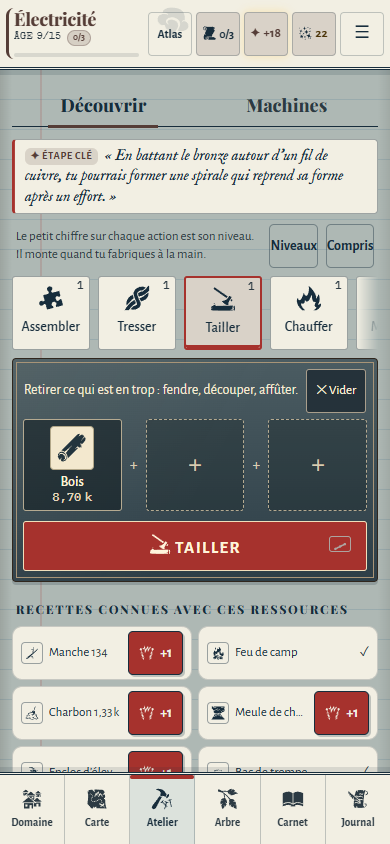
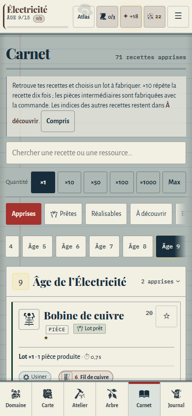
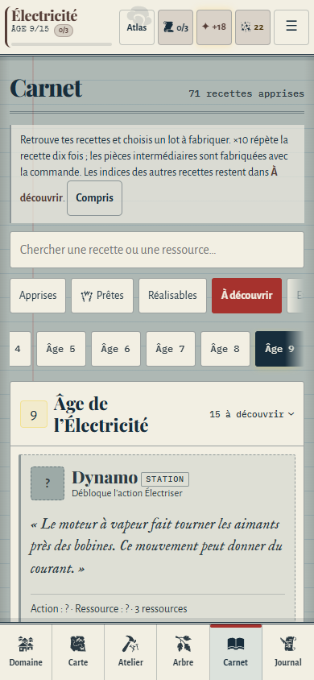
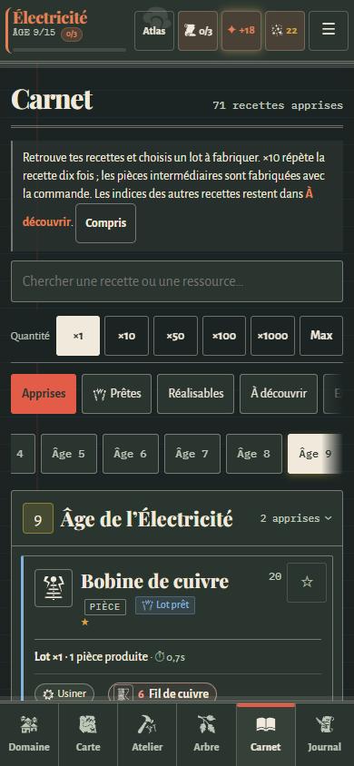

# Atlas vivant — Atelier et Carnet V4

26 octobre 2026. Branche expérimentale `prewiew-design`.

## Lot réalisé

Cette passe prolonge la direction de l’Atlas dans la boucle de découverte et de fabrication. L’Atelier devient un établi lisible ; le Carnet devient un ensemble de fiches de savoir-faire. Les illustrations de la carte restent celles de la V3, en attente du retour utilisateur.

### Atelier

- Titre de chapitre au début du jeu ; lorsque Découvrir / Machines sont disponibles, ces onglets portent déjà l’en-tête et évitent une ligne de titre supplémentaire.
- Outils gravés sur une seule rangée défilante ; sélection écrite et soulignée par l’accent de l’époque.
- Établi sombre en bois, pierre, métal ou laboratoire selon l’avancement ; instructions et matières contrastées. Les pictogrammes des matières posées restent lisibles sur ce support sombre.
- Action principale de 50 px, emplacements conservés et commandes inchangées.
- Tuiles de ressources réorganisées : pictogramme et quantité côte à côte, flux et nom complet en dessous. Les noms peuvent passer sur deux lignes. Les ressources à zéro restent lisibles, identifiées par leur quantité et un bord pointillé.
- Première rangée de ressources et gros bouton conservés dans la première vue de contrôle à 390 × 844, après fermeture de l’astuce des niveaux. Sur un écran plus petit, le petit établi suit l’exploration de l’inventaire. Sa position tient compte de la hauteur réelle de l’en-tête.

### Carnet

- En-tête compact réunissant le titre et le nombre de recettes apprises.
- Recherche, choix du lot, filtres et index des âges présentés comme les outils d’un cahier, avec un état sélectionné lisible.
- Une fiche par ligne aux petites largeurs : nom, rôle, lot, coût et commande disposent de toute la largeur. Le choix une / deux colonnes reste respecté sur grand écran.
- Titres de recettes agrandis, relevés chiffrés en monospace, énigmes en italique IM Fell English. Les noms encore cachés restent cachés.
- Actions de fabrication et boutons secondaires conservés, avec des cibles d’au moins 44 px. Le mode compact conserve des fiches resserrées.

## Corrections communes de présentation

La navigation Atlas mesurait 72 px, tandis que certaines réserves inférieures utilisaient encore une valeur plus petite. La variable commune correspond désormais à cette hauteur réelle, notamment pour l’Arbre et les actions basses.

Les encres dérivées (filets, tampons) sont calculées sur le corps de la page, avec la palette de l’époque et du thème courant. La Veillée dispose de supports réellement sombres. Les encres secondaires et sémantiques ont été ajustées pour respecter le contrôle du dépôt à 4,5:1 sur les quatre fonds, dans les six époques et les deux thèmes, y compris avec toutes les couleurs d’âge.

Les boutons courants respectent 44 px de hauteur. L’animation des bulles et du repère du tutoriel est désactivée lorsque le mouvement réduit est demandé.

## Périmètre technique

La présentation reste concentrée dans `css/design-preview.css`. Le titre d’Atelier est un ajout de présentation dans `js/atelier.js`, masqué en Classique. `js/ui.js` ajuste uniquement la position du petit établi. Les mécaniques, les données, le récit, les recettes, les coûts, la progression et le format des sauvegardes restent inchangés.

Les gravures utilisent les pictogrammes SVG existants. Ce lot ne nécessite pas de nouveaux bitmaps. Le service worker est recalculé avec l’outil du dépôt avant livraison.

## Recette

- `npm test` : syntaxe, contenu, moteur, récit, sauvegardes, build et contrôles du dépôt.
- `npm run test:design` : 320, 360, 390 et 430 px ; début, partie industrielle et thème spatial ; Jour et Veillée avec Grand texte. Vérifications de débordement, cibles tactiles, contrastes de l’établi, de l’action principale et du nom des recettes, recherche, filtres, pose et retrait de matière, bascule Classique / Atlas. Contrôles supplémentaires des réglages compact et une / deux colonnes à 900 px, et de l’absence de modification de la partie lors du rendu du Carnet.
- `npm run test:ux` : parcours existants, première fabrication, navigation, contrastes des six époques, clavier, tutoriel et confort de l’Atelier.
- `npm run test:atlas` : régression de la carte après les corrections communes de thème et de navigation ; 48 configurations, 850 contrôles passés.

Résultats : 448 contrôles spécifiques au lot, 490 contrôles UX existants et 850 contrôles de régression Atlas passent, ainsi que `npm test` et le contrôle d’empreinte.

Le navigateur utilisé est Chromium en émulation mobile, avec des profils et parties jetables. Un contrôle sur téléphone Android physique reste à faire.

## Captures du jeu à 390 × 844

## Suite prévue

1. Journal : archives, fragments et lecture ; hiérarchie et navigation documentaire.
2. Cosmos : instrument d’observation, relevés et Grands Œuvres, en cohérence avec le feuillet céleste.
3. Passe transversale sur les fiches et fenêtres, les pictogrammes et les états vides ou chargés ; revue finale des thèmes et époques.

La carte attend le retour utilisateur. Aucune fusion automatique vers `main`.
