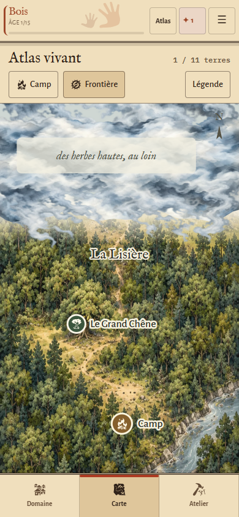
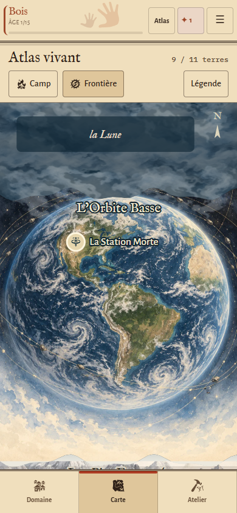
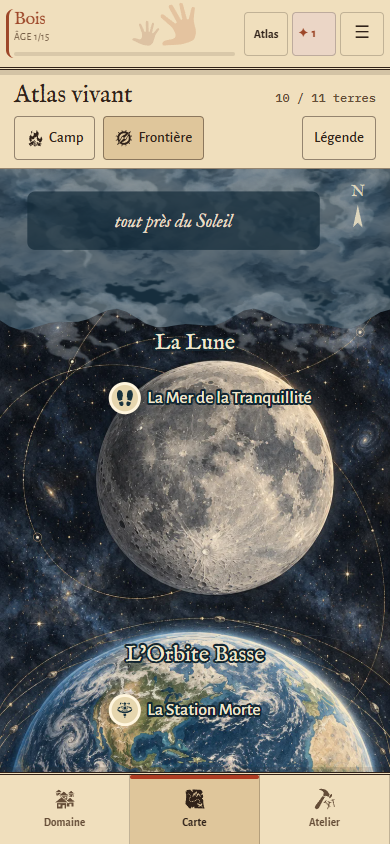
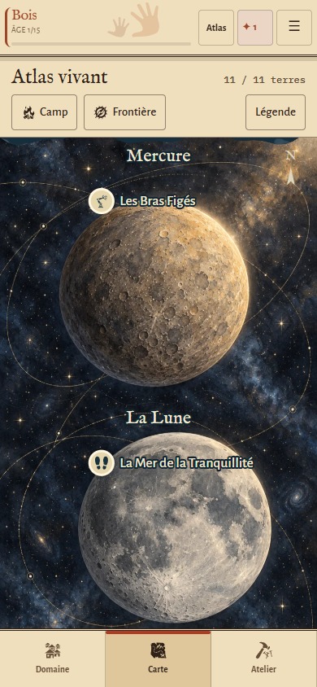

# Atlas vivant — brume et feuillet céleste V3

26 octobre 2026. Branche `prewiew-design` exclusivement.

## Retour utilisateur traité

La V2 masquait l’inconnu par un fondu dans le papier, sans donner l’impression d’un brouillard de guerre. Les régions spatiales n’avaient encore qu’une représentation géométrique. Cette passe reprend ces deux aspects sans modifier le moteur, les coûts, la découverte ou les sauvegardes.

## Brouillard

Des bancs de brume peints à l’aquarelle donnent du volume à l’inconnu. La texture comporte un vrai canal alpha : les franges s’effilochent au-dessus du terrain connu. Le champ fermé conserve un fond opaque, même dans les trous de la texture ; l’illustration des terres reste découpée aux seules bandes ouvertes. Une texture translucide ne révèle donc aucun lieu d’une terre fermée.

Les nappes sont statiques et décoratives, sans animation permanente ni interception des clics. Les libellés et les cibles sont dessinés au-dessus. Le même principe demeure valable si deux régions ouvertes sont séparées par une région fermée. La brume des régions célestes reçoit un fond nocturne et une texture atténuée.

## Feuillet céleste

Au-dessus des montagnes, le papier laisse place à une planche astronomique bleu nuit, avec astres peints, étoiles et trajectoires discrètes :

- après ouverture de l’Orbite Basse, la Terre et ses trajectoires orbitales ;
- après ouverture de la Lune, le disque lunaire et ses cratères ;
- après ouverture de Mercure, le disque ocre éclairé par le Soleil.

Une seule illustration assure la cohérence de la planche. Son découpage dépend individuellement des trois états de découverte : ouvrir l’orbite ne révèle ni l’image ni les lieux de la Lune ou de Mercure. Le cadrage garde un aperçu de la prochaine frontière. L’espace dispose de plus de hauteur, tandis que la carte terrestre conserve son échelle. La liaison inférieure de la planche s’éclaircit vers les montagnes.

Les noms et les repères spatiaux utilisent une encre claire et un contour sombre. Les lieux restent des éléments SVG accessibles avec les mêmes fiches, actions et états métier.

## Chargement et bascule

La feuille `css/carte-atlas.css` est désormais chargée directement et reste disponible. Ses règles visibles sont réservées au rendu Atlas. Ce choix supprime le bref affichage de rectangles noirs qui pouvait se produire lorsque la feuille importée se rechargeait après une bascule Classique / Atlas. Le mode Classique garde sa représentation.

Les deux nouvelles illustrations figurent dans le précache du service worker. L’empreinte est recalculée avec `node tools/build.js`.

## Validation

- `npm test` passe.
- Le contrôle Atlas couvre 48 configurations : 320, 360, 390 et 430 px ; 1, 4, 8, 9, 10 et 11 terres ; Jour puis Veillée avec Grand texte.
- Vérifications : aucune région céleste fermée dans le masque de révélation, aucun nom fermé, aucune illustration céleste avant une première découverte spatiale, cibles tactiles, absence de débordement, camp atteignable, légende et clavier, bascule immédiatement stylée.
- Contrôles dédiés : états exploré / actif / verrouillé, passage, Caveau, ouvertures non contiguës, absence de modification de la partie lors du rendu, partie industrielle existante, accès clavier aux lieux des trois astres.
- Rechargement réellement hors ligne et disponibilité des illustrations terrestre, céleste et de brume, ainsi que du mode Classique.
- Transparence WebP de la brume vérifiée : RGBA, valeurs alpha de 0 à 255. Les nouvelles images pèsent ensemble 855 090 octets.

Ces contrôles utilisent Chromium en émulation mobile. La fluidité et le rendu sur un téléphone Android physique restent à apprécier sur appareil.

## Captures du jeu à 390 × 844

La carte se parcourt verticalement. Les captures montrent la partie supérieure de chaque état ; Camp rejoint toujours la forêt.

## Sources graphiques

Illustrations originales produites avec l’outil ImageGen intégré ; aucun asset externe ajouté. Fichiers, dimensions, poids et provenance : [`assets/atlas/ATTRIBUTION.md`](../assets/atlas/ATTRIBUTION.md). Prompts complets : [`PROMPT-BRUME.txt`](../assets/atlas/PROMPT-BRUME.txt) et [`PROMPT-CELESTE.txt`](../assets/atlas/PROMPT-CELESTE.txt).

Aucune fusion vers `main`.
