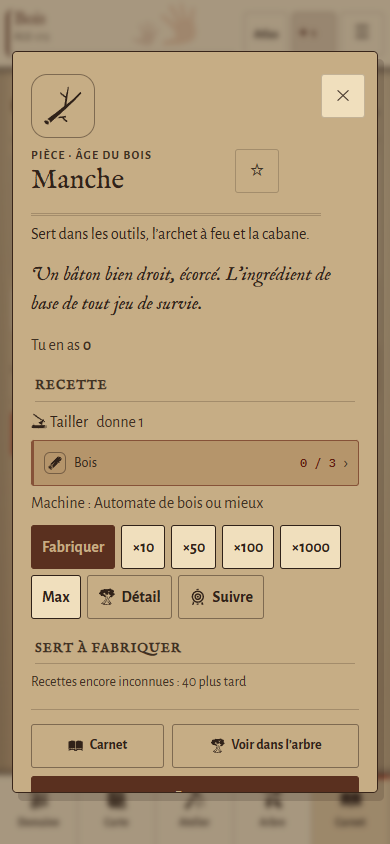
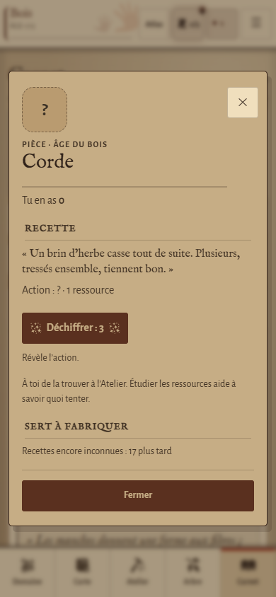
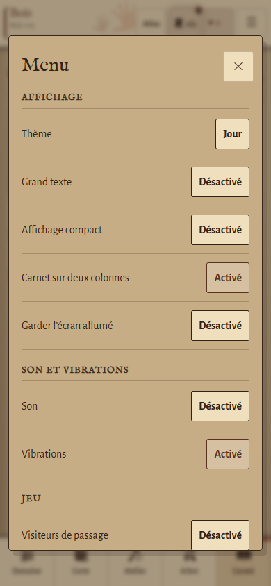
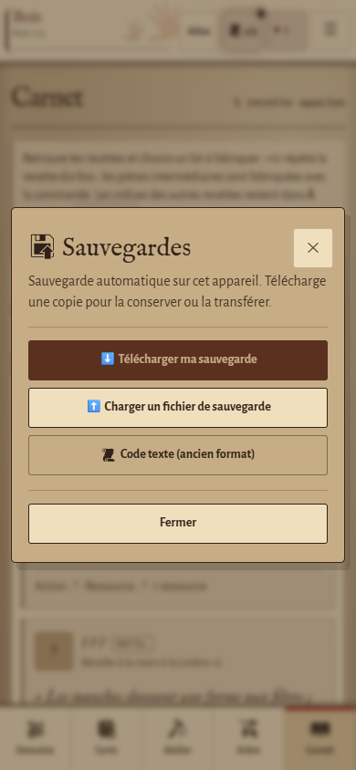
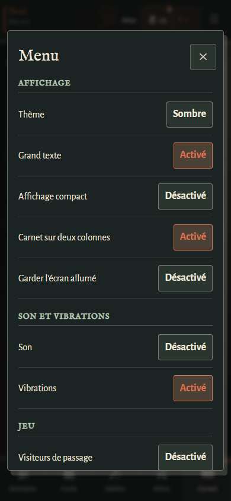

# Atlas vivant — fiches et fenêtres V6

La passe transversale prolonge le Carnet dans les fiches détaillées et les fenêtres communes. Elle reste limitée à `css/design-preview.css` : aucune recette, règle, sauvegarde ou commande n’est modifiée. La branche `main` reste indépendante et le bouton Classique désactive cette présentation.

## Présentation

- Feuilles à filet fin, titres dégagés du bouton de fermeture et sections séparées par des règles d’encre.
- Fiches : description littéraire plus ample, en-tête qui se replie, ingrédients disponibles ou manquants en lignes, navigation vers leurs fiches conservée.
- Cibles tactiles de 44 px minimum, textes secondaires agrandis et boutons indisponibles lisibles, avec contour discontinu.
- Menu : réglages espacés, entrées illustrées avec les pictogrammes SVG déjà présents ; une colonne aux plus petites largeurs et deux quand la place le permet.
- Sauvegardes, aide, champs et listes : mêmes angles, tailles et séparateurs. Aucune nouvelle illustration ni famille d’icônes.
- Grand texte et Veillée suivent les palettes de l’âge. Les scènes d’âge et de fin conservent leur cadre particulier.

## Vérification

`npm run test:fiches` utilise des parties et profils jetables à 320, 360, 390 et 430 px, au début puis à un âge industriel, en Jour et en Veillée avec Grand texte. Il contrôle les limites de fenêtre, les débordements internes, les cibles tactiles, le titre accessible, la séparation titre/fermeture et l’inactivation de l’arrière-plan.

Les parcours couvrent une recette avec matières manquantes puis disponibles, l’ouverture d’un ingrédient et le retour, une recette inconnue, le Menu, l’aide, les sauvegardes, le code texte, le téléchargement effectif d’une partie et le retour en Classique. Le Menu est aussi parcouru au clavier avec restitution du focus.

La suite UX existante et la suite Journal / Cosmos vérifient les parcours voisins et les fenêtres de lecture. Les vérifications se font avec Chromium en émulation mobile ; la recette sur un téléphone physique reste à faire.

Résultats : 944 contrôles fiches / fenêtres, 490 contrôles UX et 947 contrôles Journal / Cosmos réussis. `npm test`, le contrôle d’empreinte et la vérification des différences passent également.

## Captures à 390 × 844

Ces captures utilisent des parties de contrôle et ne représentent pas une partie personnelle.

## Suite

Revue d’ensemble des écrans et des états chargés, retour utilisateur sur la carte, puis recette sur appareil. Aucune fusion automatique vers `main`.
