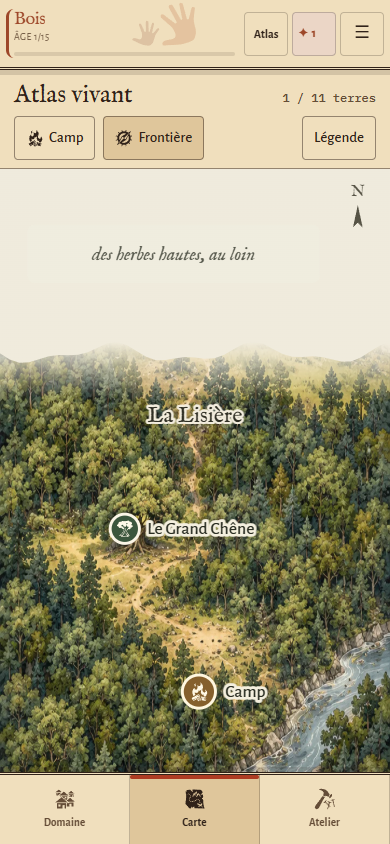
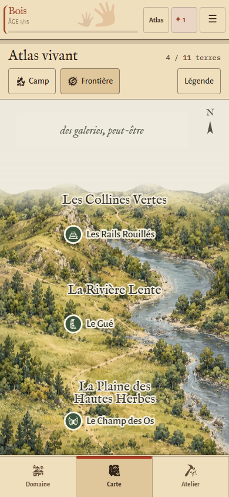

# Atlas vivant — intégration de la composition validée

26 octobre 2026. Branche : `prewiew-design`. Version jouable expérimentale ; revue visuelle sur appareil Android encore attendue.

## Résultat

La carte Atlas utilise un fond géographique continu à l’encre et à l’aquarelle. Forêt, hautes herbes, eau, collines et régions septentrionales appartiennent à une seule illustration. Les vignettes indépendantes et les ellipses hachurées disparaissent dans ce mode.

Les noms, lieux, passages et le camp restent des éléments SVG accessibles, superposés au paysage. Le moteur fournit tous les états ; les règles, les données et le format des sauvegardes n’ont pas changé. Les lieux suivants, cachés ou verrouillés reprennent les mêmes règles de visibilité que la carte Classique.

Le masque découpe uniquement les bandes des terres ouvertes. Il demeure correct lorsque les terres d’un état de contrôle ne sont pas contiguës : un territoire fermé entre deux régions ouvertes reste couvert. Une transition douce fond le bord nord dans un papier opaque ; l’indice de frontière ne révèle ni le nom ni les lieux de la terre fermée. Le Caveau n’est affiché qu’après découverte, en encart souterrain distinct. Les astres sont représentés séparément de la surface terrestre.

L’en-tête compact conserve Camp et Frontière et ouvre une légende sur demande. La Lisière occupe davantage de hauteur pour donner sa place à la forêt. Le cadrage tient compte de la surface disponible sur téléphone ; le bas réserve la place de la navigation, sans les 180 px de vide de la version précédente. Les zones tactiles SVG mesurent au moins 58 unités, soit 46,4 px à 320 px de largeur.

## Architecture

- `js/carte-atlas.js` : présentation et géographie Atlas. Aucune écriture dans le moteur.
- `js/carte.js` : délégation au rendu Atlas, actions communes et fiches existantes. Le rendu Classique est conservé.
- `css/carte-atlas.css` : style de carte, importé par la feuille expérimentale. Remplace les surcharges successives du précédent essai.
- `index.html` : la bascule reconstruit la carte et recentre la terre courante ; une simple modification de viewBox ne suffit plus aux deux compositions.
- `assets/atlas/monde-vivant-v1.webp` : fond sans texte, 724 × 2172, 601 050 octets. Provenance et prompt dans le même dossier. Production par l’outil ImageGen intégré ; aucun asset externe ajouté.
- `sw.js` : précache du nouveau fond, du module, du style et des illustrations Classiques. Empreinte recalculée avec l’outil du dépôt.

## Validation

`npm test` passe. `npm run test:atlas` vérifie la carte dans Chromium avec des profils et parties jetables : 320, 360, 390 et 430 px ; 1, 4 et 11 terres ; Jour et Veillée avec Grand texte ; absence de débordement ; cibles tactiles ; camp atteignable ; bascule Classique ; clavier ; fichiers et symboles disponibles. Les états exploré, actif, verrouillé, les passages, le Caveau et les ouvertures non contiguës font l’objet de contrôles dédiés. Le rendu est vérifié sans modification de la partie. Une partie industrielle du dépôt est également chargée. Un rechargement réel hors ligne vérifie le fonctionnement de la carte et les ressources des deux styles.

Exécution locale : `PW` peut indiquer le dossier du module Playwright et `CHROMIUM` le navigateur disponible. `ATLAS_SHOTS` indique le dossier des captures. `ATLAS_STATES_ONLY=1` ne relance que les états particuliers et le cache hors ligne.

### Captures de contrôle

Les captures ci-dessous proviennent du jeu, à 390 × 844 en émulation mobile Chromium. Elles remplacent la maquette comme référence de l’implémentation actuelle.

La carte avancée défile verticalement ; Camp permet de retrouver son point de départ.

## Limites de la recette

Les contrôles ont été réalisés dans un navigateur de bureau en émulation mobile. Ils ne confirment ni la fluidité ni le comportement de la barre du navigateur sur un téléphone Android physique. La composition spatiale reste une représentation sobre ; elle n’a pas fait l’objet d’une nouvelle planche artistique comme la surface terrestre. Ces points, ainsi que le ressenti sur la taille réelle des textes et des marqueurs, restent à revoir sur appareil.

Aucune fusion vers `main`. Les consignes de coordination de `main/docs/COORDINATION-DESIGN.md` restent applicables ; cette version reste un chantier graphique indépendant.
