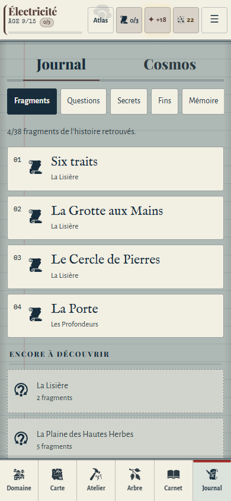
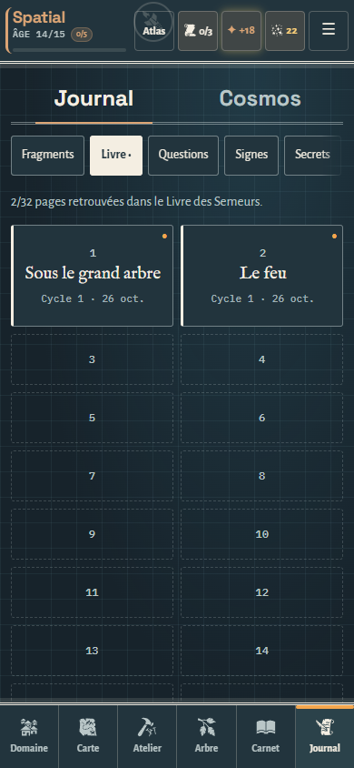
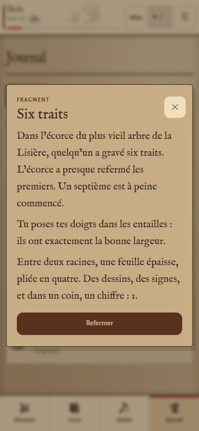
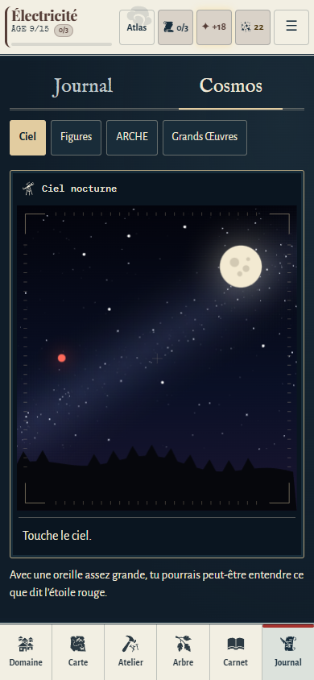
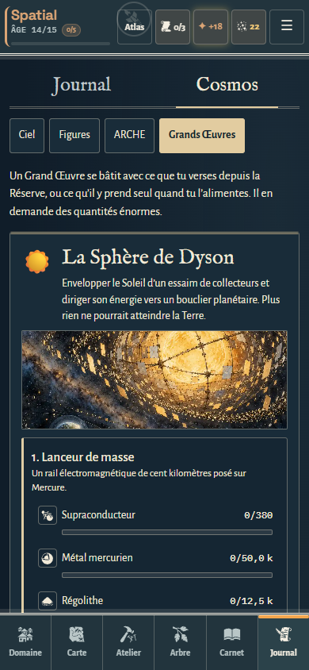

# Atlas vivant — Journal et Cosmos V5

26 octobre 2026. Branche expérimentale `prewiew-design`.

## Journal : des archives à parcourir

Les fragments retrouvés deviennent des fiches d’archives : index de lecture, gravure existante, titre en IM Fell English, provenance et date distinctes. Les fragments inconnus restent anonymes et lisibles ; leur opacité ne réduit plus celle de tout le texte.

Le Livre présente deux pages par ligne sur téléphone, avec les titres complets des pages retrouvées. Les emplacements manquants sont plus courts et ne portent que leur numéro. Sur grand écran, l’index garde quatre colonnes.

Les Questions, Signes, Secrets et relevés de Mémoire reprennent la même hiérarchie : titre, contenu, puis commande ou métadonnée. Les questions résolues et les secrets fermés restent lisibles sans dépendre seulement d’une variation de couleur. La flûte s’adapte à 320 px en conservant cinq cibles d’au moins 44 px.

Les fenêtres contenant du récit reçoivent une lecture plus ample : texte imprimé en IM Fell English, interligne augmenté, titre séparé des relevés ; les annotations manuscrites conservent Caveat et leur signature. Aucun texte du récit n’a été réécrit.

## Cosmos : un instrument d’observation

La vue dispose d’une palette nocturne cohérente, indépendante du papier de l’époque. Elle remplit la hauteur disponible, y compris lorsque le terminal ne contient que quelques lignes.

Le ciel existant reste un canvas interactif. Son cadre gagne un cartouche, des repères de bord et une croix discrète, dessinés en SVG. Ces ornements n’interceptent aucun geste et n’ajoutent aucune fausse mesure. La consigne et le résultat d’une observation sont placés sous le champ, avec un statut accessible ; ils ne recouvrent plus les étoiles.

Les Figures restent issues des fragments et signes du moteur. La console ARCHE / REGISTRE utilise des caractères plus lisibles, un champ de commande distinct et le même historique. Les Grands Œuvres gardent leurs étapes, coûts et actions, avec leurs illustrations existantes, une typographie hiérarchisée et des lignes de coût qui se replient dans la largeur utile.

## Préservation des règles et de la découverte

Le seul changement de JavaScript dans le jeu est la structure de présentation autour du canvas : cartouche, gravure SVG, nom accessible et statut de l’observation. Les coordonnées du canvas, ses gestes, la sélection des étoiles et les commandes du terminal sont conservés.

Les conditions d’accès aux onglets viennent toujours du moteur. Les pages absentes ne montrent aucun titre et ne deviennent pas interactives. Les secrets non découverts conservent leurs noms cachés. Lire une page ou jouer de la flûte garde exactement ses effets existants.

La carte et ses illustrations ne sont pas modifiées dans cette passe. Les données, la progression, les sauvegardes et le récit restent inchangés. Le mode Classique reste disponible.

## Ressources et hors ligne

Cette passe utilise les SVG existants et les illustrations existantes des Grands Œuvres. Leurs cinq images complètes sont ajoutées au précache pour rester disponibles même avant la première ouverture de cet onglet hors ligne. Aucun nouveau bitmap n’est produit.

Le build est recalculé avec `node tools/build.js`, puis vérifié avec `--check`.

## Recette

- `npm test` : contrôles du dépôt, moteur, sauvegardes, récit et build.
- `npm run test:archives` : 320, 360, 390 et 430 px ; Journal naissant, partie avancée et état documentaire chargé ; Jour et Veillée avec Grand texte. Les parties de contrôle sont jetables.
- Vérifications : absence de débordement, cibles tactiles de 44 px, onglets disponibles, clavier pour les fragments, les pages et les Figures, noms des secrets et titres manquants préservés, flûte et terminal fonctionnels.
- Le test touche Véga à sa position relative dans le canvas, puis vérifie la réponse : le cadre n’a pas déplacé les coordonnées ni intercepté les gestes. Le ciel reste démonté lorsqu’on quitte son onglet.
- Après un vrai rechargement hors ligne : lecture d’une page du Livre, ciel dynamique et illustration d’un Grand Œuvre encore disponibles.
- `npm run test:ux` : parcours et contrôles transversaux existants.

Les contrôles utilisent Chromium en émulation mobile. Le confort de lecture et la fluidité sur un téléphone Android physique restent à apprécier sur appareil.

Résultats : 947 contrôles Journal / Cosmos et 490 contrôles UX existants passent, ainsi que `npm test` et le contrôle d’empreinte.

## Captures de contrôle à 390 × 844

Les états avancés et chargés utilisent des parties de contrôle pour couvrir les composants. Ils ne représentent pas la partie personnelle du joueur.

## Suite

Les écrans principaux disposent désormais de leur première passe Atlas. Restent la finition transversale des fiches et fenêtres, la cohérence des pictogrammes, les états vides ou très chargés et la revue d’ensemble sur appareil. La carte attend le retour utilisateur. Aucune fusion automatique vers `main`.
