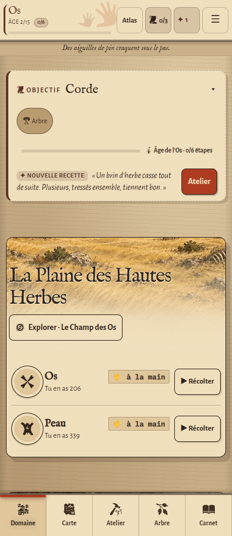
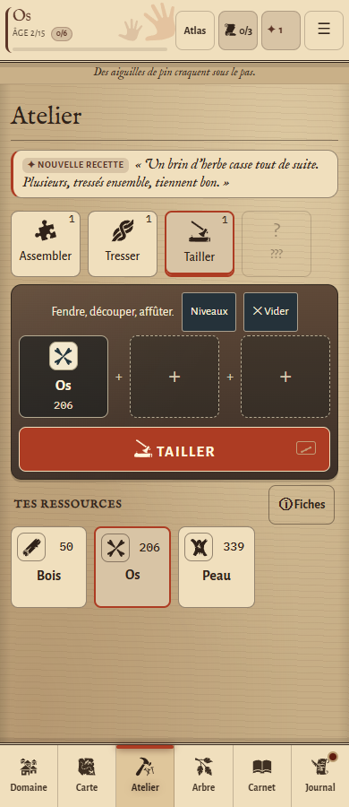
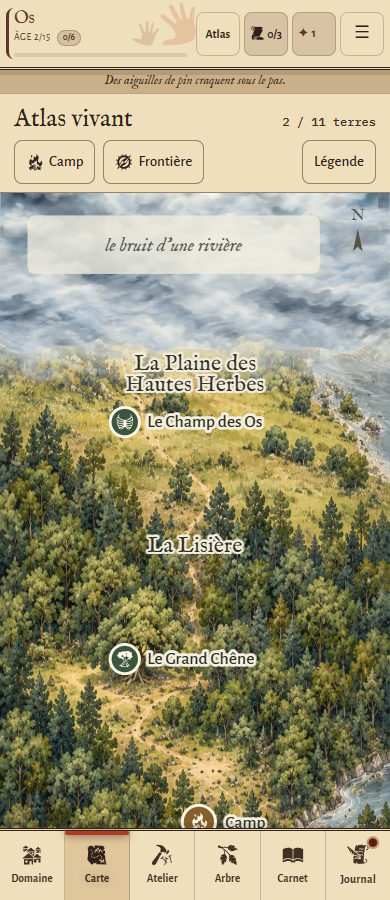
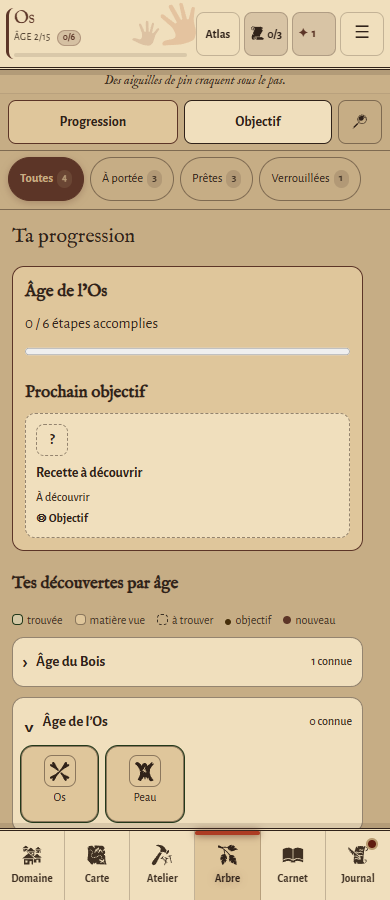
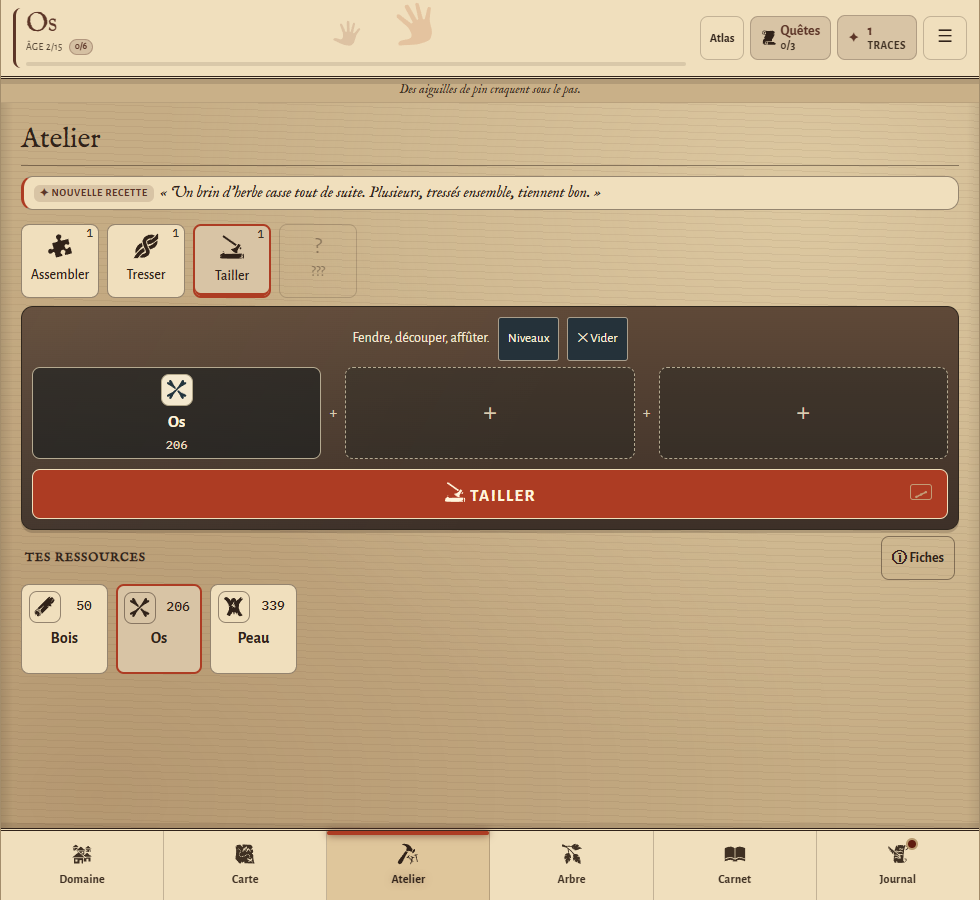

# Atlas vivant — retours visuels V7, 27 octobre 2026

## Synchronisation

La PR #119 a intégré la version graphique publiée à `main`. Depuis, le Menu, les quantités libres, l’ambiance, le Livre, la transmission et la progression ont évolué. Cette passe conserve ces changements en synchronisant `prewiew-design` avec `main` à `b126bcb`, version 0.37.0. Seule l’empreinte générée du service worker a demandé une résolution de conflit ; elle est recalculée avec l’outil de construction.

Les retouches locales commencées le 26 octobre ont été sauvegardées avant cette synchronisation, puis reprises. Aucune modification n’est poussée sur `main`.

## Corrections issues des captures

- **Bande claire du Domaine :** ancien décalage de 30 px supprimé ; le paysage commence au bord supérieur du panneau, sous son arrondi.
- **Brume :** deux couches à la frontière, fondu vertical et filtre SVG de déformation limité à cette bordure. Elles dérivent en sens opposés ; le champ fermé reçoit une texture décalée supplémentaire pour casser les grands vides uniformes. Le voile opaque et le découpage des illustrations restent indépendants de l’animation : les terres fermées ne sont pas révélées. Ce rendu utilise le SVG et les transformations CSS, sans moteur WebGL. Mouvements réduits : image fixe ; carte masquée : animation en pause.
- **Arrondis :** panneaux de 12 px, fenêtres de 16 px et commandes de 8 px. Les repères circulaires de la carte et du Domaine restent des repères, pas une autre famille de boutons.
- **Atelier :** nom de la ressource posé sur l’établi agrandi (17 px), quantité sur une ligne séparée et noms de l’inventaire à 16 px. Les deux astuces fixes avec « Compris » sont retirées ; le guide, les fiches et le bouton Niveaux restent disponibles.
- **Texte :** sous-titre « Le geste et la matière » retiré ; l’instruction de Tailler devient « Fendre, découper, affûter. ». Les changements de vocabulaire de `main` sont conservés : Objectif, Atelier, Nouvelle recette, Requis. Le récit est préservé.
- **Recette inconnue de l’objectif :** suppression du double contour épais ; bordure fine discontinue et petit point coloré, repris dans la légende.
- **Compatibilité avec le nouveau Menu :** onglets de 44 px minimum et disposition en deux colonnes sur mobile ; titre reconnu par le système des fenêtres et les lecteurs d’écran.
- **Explication des commandes :** info-bulle ajoutée au raccourci Mémoire des mains du Journal.
- **Hauteur mobile :** quelques espacements de l’Atelier resserrés pour accueillir la nouvelle ligne d’ambiance en gardant l’action et une première rangée de matières visibles.

## Vérification

Les contrôles utilisent des parties et profils jetables, sans compte distant ni partie personnelle. `test:retours` reproduit les éléments signalés à 320, 390 et 980 px, en Jour et en Veillée / Grand texte. Il vérifie aussi que la brume se déplace réellement et qu’elle reste fixe avec les mouvements réduits.

Les suites existantes couvrent les recettes, les fiches, le Menu, les sauvegardes, le Livre, les parcours de jeu et la carte (y compris ses terres célestes et son fonctionnement hors ligne). La fluidité sur téléphone physique reste à apprécier sur appareil.

Résultats : 78 contrôles ciblés des retours, 448 Atelier / Carnet, 850 Carte, 944 Fiches / fenêtres, 1 019 Journal / Cosmos et 490 UX mobile réussis.

L’inventaire généré relève 226 commandes, sans commande dépourvue d’explication. `npm test`, le contrôle des différences et celui de l’empreinte du cache passent.

## Captures de contrôle

