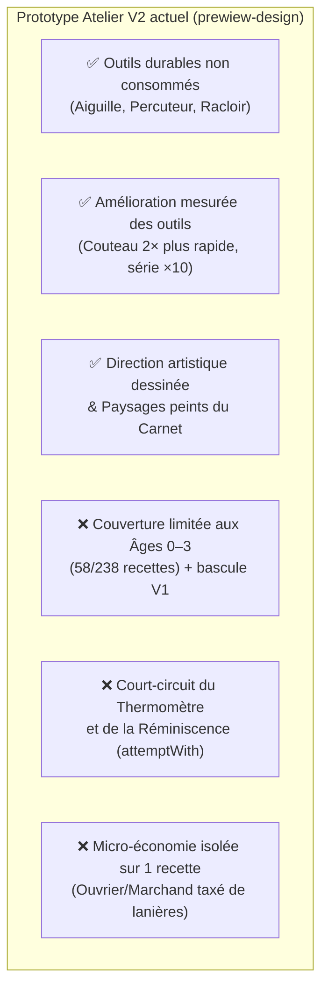

# Étude Personas & Direction Stratégique — L'Atelier V2 (`prewiew-design`)

> [!NOTE]
> **Contexte du test**
> Cette session de playtest réunit nos **6 personas** (**Martine**, **Léa**, **Enzo**, **Thomas**, **Julien** et **Chloé**) sur la branche `prewiew-design` (`b19cd7c`), fraîchement synchronisée avec `main` (`ca506df`).
> Elle intègre l'ensemble des chantiers validés précédemment :
> - **PR #157** : Équilibrage des relèves (front pionnier `maxAge`, ruines des stations uniques, élan de rattrapage).
> - **PR #160** : Correctifs pré-alpha (résolution récursive des ruines, coût réel du Raccourci, passage Plaine, onglet Mémoire).
> - **PR #161 (Lot 1 — C & D)** : Miroir du cycle (splits par terre), échos narratifs des ruines, Grand texte dès l'éveil, célébration d'ouverture de terre.
> - **PR #164 (Lot 2 — A & B)** : Découverte accompagnée à l'établi (nombre d'ingrédients, pose directe de l'indice, déchiffrage in-situ) et Cadences d'atelier (maintien automatique de stock par les machines libres).

---

## 1. Validation rapide du socle fusionné (Lots 1 & 2 + Correctifs)

Avant d'évaluer la V2 de l'Atelier, les 6 testeurs ont vérifié leurs irritants de la session précédente :
- **Martine (60 ans)** et **Léa (27 ans)** saluent le bouton **« Grand texte : Activé » dès l'écran d'éveil**, la disparition totale des blocages de ruines après relève, et la **fenêtre de célébration** à l'ouverture de la Plaine et des Collines.
- **Chloé (20 ans)** et **Enzo (14 ans)** confirment que le bandeau **« ✦ Nouvelle recette · 1 ressource »** accompagné des boutons **« Poser l'indice sur l'établi »** et **« ✨ Déchiffrer »** transforme l'expérience de recherche : plus aucun aller-retour aveugle avec le Carnet.
- **Thomas (30 ans)** et **Julien (32 ans)** valident les **Cadences d'atelier** dans `Machines` et le **Miroir du cycle** à la relève : maintenir automatiquement un tampon de 50 cordes, 100 charbons ou 50 briques pendant que les machines sont au repos supprime la micro-gestion répétitive du milieu de partie.

---

## 2. Avis détaillés des 6 Personas sur la V2 de l'Atelier (`atelier-equipe.js`)

Dans `prewiew-design`, l'Atelier classique (V1 : 1 barre de gestes + 3 emplacements + thermomètre) est remplacé de l'Âge 0 à l'Âge 3 par l'**Atelier équipé (V2)** ([`js/atelier-equipe.js`](file:///C:/Users/sylva/OneDrive/Documents/ChatGPT/Eclat/gemini-preview/js/atelier-equipe.js), [`js/equipements.js`](file:///C:/Users/sylva/OneDrive/Documents/ChatGPT/Eclat/gemini-preview/js/equipements.js), [`js/atelier-economie.js`](file:///C:/Users/sylva/OneDrive/Documents/ChatGPT/Eclat/gemini-preview/js/atelier-economie.js)).

Voici les retours documentés de chacun des 6 profils après une partie complète jusqu'à l'Âge 5 (Acier / Vapeur).

---

### 👵 Martine (60 ans) — Néophyte mobile (Candy Crush), joue sur iPhone (390×844) en Grand texte

#### Ce qu'elle a aimé
- **Le départ immédiat** : « Au tout début, le *Percuteur de pierre* est déjà choisi sur l'Établi avec le bouton *Tailler*. J'ai juste touché *Bois* puis *Tailler*, et j'ai eu mon manche. C'est rassurant. »
- **Les noms concrets** : « Choisir *Mains* pour *Tresser* une corde ou *Aiguille en os* pour *Coudre* une outre me parle plus que des icônes abstraites. »

#### Ce qui l'a bloquée ou perdue
1. **L'empilement vertical sur téléphone** : « Dès que j'ai construit le Feu de camp et débloqué la Lanière, la page Atelier est devenue immense. Sur mon écran, j'ai : les sous-onglets, l'encart d'indice, les boutons de Postes (*Établi / Foyer*), les 3 cases de l'établi, le bloc *Tes outils*, puis *Tes matières*, puis *Recettes*, puis un énorme bloc *Faire vivre l'atelier* (Bourse, Ouvrier, Marchand), et enfin *Commandes* tout en bas. Je passe mon temps à monter et descendre. »
2. **La confusion Poste vs Outil** : « Pour faire un épieu avec mes manches, le jeu me disait que l'action était *Chauffer*. J'ai cherché le feu dans *Tes outils* à droite de l'établi… il n'y était pas ! J'ai mis cinq minutes à voir qu'il était tout en haut dans une autre barre (*Établi | Foyer*). »
3. **Le choc du bouton « Procédés après le Cuivre » (Âge 3)** : « Arrivée au Cuivre/Bronze, un bouton *Procédés après le Cuivre* est apparu. J'ai cliqué dessus et tout mon atelier a changé de forme ! Je me suis demandé si j'avais cassé le jeu ou changé de mode sans faire exprès. »

> **Verdict de Martine : 5,5 / 10** — *« J'aime l'idée que l'aiguille serve à coudre sans disparaître, mais sur téléphone il y a trop de blocs les uns sous les autres, et le changement d'atelier après le Cuivre me perd complètement. »*

---

### 🌿 Léa (27 ans) — Joueuse cosy-craft & narrative (Stardew Valley, Strange Horticulture)

#### Ce qu'elle a aimé
- **La matérialité du geste artisanal** : « C'est le gros point fort de cette V2. Avoir son *Percuteur de pierre*, façonner un *Racloir en os* avant d'avoir accès au silex de la Rivière, et surtout **garder son Aiguille en os** pour coudre l'outre et la tunique ou percer la flûte sans que l'aiguille soit détruite dans la recette : c'est mille fois plus logique et poétique ! »
- **Les trois allures du Foyer** : « Distinguer *Chauffer doucement* (épieu, colle d'os), *Cuire* (brique) et *Carboniser à l'étouffée* (charbon) sur le Foyer donne une vraie sensation d'atelier vivant, très cohérente avec la direction artistique dessinée ([`css/atelier-dessine.css`](file:///C:/Users/sylva/OneDrive/Documents/ChatGPT/Eclat/gemini-preview/css/atelier-dessine.css)). »

#### Ce qui l'a déçue ou brisé son immersion
1. **La dissonance narrative de l'Ouvrier salarié et du Fisc à l'Âge de l'Os** : « Je suis un Semeur solitaire qui taille des os dans une clairière préhistorique, et soudain, dès que je découpe une lanière de cuir, un panneau *Faire vivre l'atelier* apparaît avec des **écus**, une **avance sur salaire**, un **marchand automatique toutes les 5 secondes** et des **tranches marginales d'imposition à 10 %, 20 %, 30 %, 40 %, 50 %** ! Ça casse complètement la poésie de l'Âge de l'Os. En plus, on découvre le vrai Troqueur bien plus tard avec une vraie histoire. »
2. **La disparition des petits textes d'échec et du thermomètre** : « Dans l'atelier classique, quand je tente un essai raté, le jeu me répond avec une petite phrase écrite à la main et me dit si je suis *Tiède* ou *Chaud*. Dans la V2, ça me répond froidement : *"Ce geste ne donne rien avec ces matières. Essaie un autre outil ou une autre combinaison."* »
3. **L'abandon des outils après le Cuivre** : « Pourquoi cette belle logique d'outils s'arrête-t-elle pile au Cuivre ? »

> **Verdict de Léa : 7 / 10 (9/10 pour les outils durables et le Foyer, 3/10 pour l'Ouvrier/Marchand fiscalisé)** — *« Gardez absolument les outils durables (aiguille, racloir, couteau, percuteur) et l'esthétique dessinée, mais retirez la feuille d'impôts de l'Âge de Pierre et rendez-nous les phrases du thermomètre ! »*

---

### ⚡ Enzo (14 ans) — Joueur mobile natif (Brawl Stars, Clash Royale), cherche du rythme

#### Ce qu'il a aimé
- **Le bouton de série directe sur l'outil (`Couper ×5`, `Couper ×10`)** : « Quand j'ai le racloir ou le couteau, le bouton *Couper ×10 · 4s* directement sous l'établi est super pratique. »
- **Le comparateur de vitesse sur le Couteau** : « Voir écrit directement sur le bouton du Couteau de silex *"Couper ces lanières : 0,9s → 0,4s"* donne tout de suite envie de le fabriquer. »

#### Ce qui l'a frustré
1. **Perte totale du Thermomètre ET de la jauge de Réminiscence lors des essais** :
   - En auditant [`js/equipements.js`](file:///C:/Users/sylva/OneDrive/Documents/ChatGPT/Eclat/gemini-preview/js/equipements.js#L149-L160), `E.attemptWith` vérifie d'abord `const recipe = E.equipmentRecipe(equipment, mode, parts); if (!recipe) return { kind: "equipment", why: "incompatible" };` **avant** d'appeler `E.attempt(...)`.
   - Conséquence découverte par Enzo : « Quand je cherche une recette en tâtonnant, si je n'ai pas pile le bon outil ET le bon mode ET les bonnes matières d'un coup, non seulement je n'ai **aucun indice Chaud/Tiède/Froid**, mais en plus **ma barre de Réminiscence ne monte même pas** ! »
2. **Trop de clics pour changer de fabrication** : « En V1, je clique sur *Chauffer* puis *Bois* puis *Chauffer* = 3 clics au même endroit. En V2, je dois monter cliquer sur *Foyer*, descendre cliquer sur *Bois*, remonter cliquer sur *Carboniser*, puis recliquer sur *Établi* pour la suite. »

> **Verdict d'Enzo : 5 / 10** — *« Le bonus ×2 du couteau est cool, mais chercher une recette sans le thermomètre Chaud/Froid, c'est juste du hasard aveugle parmi 17 modes d'outils. »*

---

### ⚙️ Thomas (30 ans) — Vétéran Factorio / Satisfactory dans le métro

#### Ce qu'il a aimé
- **La distinction claire entre Outil (catalyseur non consommé) et Ingrédient (consommé)** : « Dans la V1, devoir consommer 2 aiguilles en os pour fabriquer une outre en cuir ou 1 éclat de silex par engrenage de bois était une hérésie d'ingénieur : un outil ne s'incorpore pas dans le produit fini ! La V2 corrige ça très proprement dans [`js/equipements.js`](file:///C:/Users/sylva/OneDrive/Documents/ChatGPT/Eclat/gemini-preview/js/equipements.js#L14-L15). »
- **Les Cadences d'atelier (Lot 2) dans l'onglet Machines** : « Pouvoir fixer un seuil de stock (ex. 50 cordes, 100 briques) sur mes automates au repos et voir qu'ils rendent immédiatement la main dès qu'une commande prioritaire tombe, c'est exactement ce que j'attendais. »

#### Ce qu'il critique sévèrement (Architecture & Économie)
1. **Le doublon incohérent entre l'Ouvrier de l'Atelier (`atelier-economie.js`) et les Machines + Comptoir du Domaine** :
   - « Pourquoi avoir créé un sous-système économique parallèle qui ne fonctionne **que pour une seule ressource sur 267** (`laniere`) ? »
   - « J'ai fait le test : j'embauche l'ouvrier (3,13 écus), je lui avance 5 écus, j'active le marchand automatique. En 56 secondes avec le couteau, l'ouvrier produit 128 lanières, le marchand m'en vend 108 et verse **11,56 écus nets** dans ma bourse… et à la 57e seconde, **l'ouvrier s'arrête avec le statut "Avance de salaire épuisée"** alors que j'ai 28 écus en bourse ! Il faut cliquer manuellement sur *Avancer 1 écu* toutes les minutes. »
   - « Pire : juste à côté, dans le sous-onglet *Machines*, mon *Automate de bois* avec une *Cadence d'atelier* (Lot 2) découpe mes lanières gratuitement, sans salaire, sans taxe marginale et sans clic manuel ! »
2. **La cassure à l'Âge 3** : « Dès qu'on entre dans l'industrialisation (Acier, Vapeur, Électricité — le cœur de cible Factorio), la V2 s'arrête et nous renvoie vers l'interface V1 via le bouton *Procédés après le Cuivre*. »

> **Verdict de Thomas : 6 / 10** — *« La séparation Outil durable / Ingrédient consommé est excellente et doit être gardée dans le jeu principal. En revanche, l'usine à gaz "Ouvrier de lanières + Marchand taxé par tranches" fait doublon avec les Machines/Cadences et le Comptoir du Troqueur : il faut la supprimer ou l'unifier. »*

---

### 📈 Julien (32 ans) — Fan d'idle games / incrémentaux (Kittens Game, Universal Paperclips)

#### Ce qu'il a aimé
- **Les paliers d'outils à bénéfice mesuré** : « Passer du *Racloir en os* (série ×5, vitesse ×1) au *Couteau de silex* (série ×10, vitesse ×2) crée une micro-boucle de progression très satisfaisante à l'Âge 1–2. Et combiné au bonus de Maîtrise de la Plaine (+5 % à +50 %), on sent vraiment le débit décoller. »
- **Le nouveau rythme des Relèves (PR #157) + Miroir du cycle (Lot 1)** : « Le problème de la relève proposée trop tôt pendant qu'on reconstruit son domaine est 100 % réglé grâce au verrou sur `maxAge`. Et voir ses temps de passage en vert (`-1m 42s`) dans le Miroir du cycle donne envie d'optimiser ses runs. »

#### Ce qu'il pointe sur la courbe de progression (et Piste 2 mi-partie)
1. **Le gouffre entre l'Âge 3 (100 % équipé) et les Âges 4 à 14 (0 % équipé)** :
   - Sur les **238 recettes** du jeu, seules **58 recettes** (Âges 0 à 3) sont déclarées dans `D.CRAFT_EQUIPMENT.recipes`. Les **180 recettes suivantes** (Âges 4 à 14) n'ont aucun équipement associé.
2. **Le ressenti sur la mi-partie (Piste 2 : Âges 4 à 8, Bronze → Électricité)** :
   - « Avec les **Cadences d'atelier** (Lot 2) qui maintiennent mes stocks de *charbon*, *briques*, *fils de cuivre* et *verre* en tâche de fond, la transition Âge 4 → Âge 7 est déjà beaucoup plus fluide qu'avant. Ce qui manque encore aux Âges 5–8 pour égaler le plaisir des Âges 0–3, c'est d'avoir là aussi **1 ou 2 outils/améliorations de vitesse d'atelier par âge** (comme le Couteau l'est pour le Cuir). »

> **Verdict de Julien : 6,5 / 10** — *« Ne jetez surtout pas l'idée des outils qui doublent la vitesse et la taille des séries ! Mais au lieu d'en faire un mini-jeu isolé qui s'arrête au Cuivre, intégrez ce principe simplement du Bois jusqu'au Stellaire. »*

---

### 📱 Chloé (20 ans) — Joueuse casual mobile, sessions de 5–10 min dans les transports

#### Ce qu'elle a aimé
- **Le filtre « À découvrir » couplé à l'outil** : « Quand j'ai étudié mes ressources avec l'Intuition, cocher *À découvrir* dans la V2 est super malin : ça ne garde à l'écran que les matières qui cachent une recette avec l'outil que j'ai en main. »
- **L'intégration du bandeau « Poser l'indice sur l'établi » (Lot 2)** : « Quand je déchiffre un indice dans le bandeau du haut et que je clique sur *Poser l'indice sur l'établi*, ça sélectionne automatiquement le bon poste, le bon outil et la bonne matière ! »

#### Ce qui l'a gênée
1. **Sans indice déchiffré, trop de combinaisons muettes** : « En V1, il y a 7 gestes au début. En V2, entre les 5 postes, les 11 outils et leurs modes, il y a **17 modes de fabrication**, et quand on se trompe d'outil, le jeu ne dit même pas si on a mis les bonnes ressources (pas de thermomètre). Donc sans utiliser le bouton *Déchiffrer*, on est obligé de deviner à l'aveugle. »
2. **La barre compacte `.ae-mini` et le défilement** : « Sur mon téléphone, la liste des recettes connues (*Préparer / Fabriquer*) est tout en bas sous les matières, alors qu'on s'en sert tout le temps. »

> **Verdict de Chloé : 6,5 / 10** — *« Le filtre "À découvrir" et le bouton "Poser l'indice" marchent super bien, mais l'écran est trop long sur mobile et le manque du thermomètre punit trop les essais libres. »*

---

## 3. Synthèse Multi-Casquettes (Designer, Commercial, Développeur, Lead)

### Tableau récapitulatif des 6 Personas sur la V2 de l'Atelier

| Composant de la V2 (`prewiew-design`) | Martine (60) | Léa (27) | Enzo (14) | Thomas (30) | Julien (32) | Chloé (20) | Bilan |
| :--- | :---: | :---: | :---: | :---: | :---: | :---: | :--- |
| **Outils durables non consommés** (`aiguille`, `percuteur`, `racloir`) | 👍 | ❤️ | 👍 | ❤️ | 👍 | 👍 | **Unanimité absolue (6/6)** |
| **Paliers d'outils à vitesse mesurée** (`racloir` ×1 → `couteau` ×2) | 👍 | 👍 | ❤️ | ❤️ | ❤️ | 👍 | **Unanimité absolue (6/6)** |
| **Modes thermiques du Foyer/Four** (`Doux`, `Vif`, `Étouffée`, `Fonte`) | 😐 | ❤️ | 😐 | 👍 | 👍 | 😐 | **Apprécié si guidé par le thermomètre** |
| **Habillage dessiné & paysages peints** (`atelier-dessine.css`) | 👍 | ❤️ | 👍 | 👍 | 👍 | ❤️ | **Unanimité absolue (6/6)** |
| **Absence du Thermomètre & Réminiscence sur mauvais outil** | ❌ | ❌ | ❌ | ❌ | ❌ | ❌ | **Rejet unanime (bloquant)** |
| **Bascule « Procédés après le Cuivre » à l'Âge 3** | ❌ | ❌ | ❌ | ❌ | ❌ | ❌ | **Rejet unanime (cassure UX)** |
| **Micro-économie « Ouvrier de lanières + Marchand taxé »** | ❌ | ❌ | 😐 | ❌ | 😐 | ❌ | **Rejeté (doublon avec Cadences & Troqueur)** |

---

### Analyse par rôle

1. **Point de vue Game Designer** :
   - La V2 contient **deux pépites de game design** :
     1. *Les outils sont des catalyseurs durables et non des ingrédients détruits* (plus besoin de détruire 2 aiguilles en os pour coudre une outre).
     2. *Un outil plus avancé accélère visiblement un procédé* (le Couteau de silex qui divise par 2 le temps des lanières et double la taille de série de ×5 à ×10).
   - En revanche, séparer l'interface en deux mondes incompatibles (V2 jusqu'au Cuivre sans thermomètre, puis retour forcé en V1 après le Cuivre) brise l'apprentissage du joueur. Et la micro-économie de lanières (Ouvrier + Marchand fiscalisé) est hors-sujet maintenant que nous avons les **Cadences d'atelier** (Lot 2) et le **Comptoir du Troqueur**.
2. **Point de vue Commercial / Marketing** :
   - L'habillage **Carnet peint + Atelier dessiné** ([`css/atelier-dessine.css`](file:///C:/Users/sylva/OneDrive/Documents/ChatGPT/Eclat/gemini-preview/css/atelier-dessine.css), [`css/carnet-peint.css`](file:///C:/Users/sylva/OneDrive/Documents/ChatGPT/Eclat/gemini-preview/css/carnet-peint.css)) donne à *Éclat* une signature visuelle unique sur le marché idle/craft mobile, très loin des tableaux austères habituels.
   - Mais la longueur de page sur mobile (390 px) dans `atelier-equipe.js` nuit au taux de rétention des premières minutes.
3. **Point de vue Développeur / Architecte** :
   - Aujourd'hui, [`js/equipements.js`](file:///C:/Users/sylva/OneDrive/Documents/ChatGPT/Eclat/gemini-preview/js/equipements.js) crée un numéro de version de sauvegarde distinct (`SAVE_VERSION = 13` contre `12` sur `main`) et une clé `localStorage` séparée (`eclat.preview.craft.v1`), ce qui empêche l'import/export transparent entre `main` et `prewiew-design`.
   - Maintenir deux moteurs d'atelier (`atelier.js` + `atelier-equipe.js`) en parallèle dans le même onglet double la surface de bugs.
4. **Point de vue Lead / Product** :
   - Nous avons désormais toutes les cartes en main pour **converger vers une version unifiée** avant l'Alpha : garder 100 % de ce qui fait briller la V2 (outils durables, vitesse d'outil ×2, direction artistique dessinée) tout en éliminant la cassure de l'Âge 3 et l'usine à gaz de l'ouvrier/marchand de lanières.

---

## 4. Quelles directions pour la suite ? (3 Pistes au choix)

Voici **3 pistes claires** pour décider de la direction à donner à l'Atelier :

### 🌟 Piste 1 (Recommandée) — L'Atelier Unifié « Gestes, Outils durables & Thermomètre » (Convergence V1 + V2 sur les 15 Âges)
**Principe** : Unifier le meilleur de V1 et V2 dans une seule interface compacte, continue de l'Âge 0 à l'Âge 14, sans bascule « Procédés après le Cuivre » :
1. **Rapatrier les Outils durables et les paliers de vitesse de la V2 dans tout le jeu** :
   - L'*Aiguille en os* devient un outil durable (non consommé dans l'outre, la tunique, la flûte).
   - Le *Racloir en os* (Âge 1) puis le *Couteau de silex* (Âge 2, vitesse ×2 sur les découpes) sont intégrés nativement, **et on prolonge cette logique aux âges suivants (Piste 2 mi-partie)** avec un outil catalyseur par grande ère (ex. *Ciseau de bronze*, *Filière d'acier*, *Chalumeau*, *Fer à souder*) qui double la vitesse des composants clés de son âge !
2. **Conserver le Thermomètre (`Froid / Tiède / Chaud / Brûlant`) et la Jauge de Réminiscence** sur 100 % des tentatives : si le joueur a les bons ingrédients mais le mauvais geste ou qu'il lui manque l'outil/station requis, le thermomètre s'allume (*Brûlant ! Il te faut : Aiguille en os*) et la recette s'inscrit ou fait progresser la réminiscence.
3. **Conserver l'habillage visuel dessiné (`atelier-dessine.css` + `carnet-peint.css`)** sur l'Atelier unifié, tout en gardant la compacité mobile de la V1 (établi + matières visibles dès le premier écran sur 390×844).
4. **Retirer la micro-économie isolée (`atelier-economie.js` : Ouvrier/Marchand taxé de lanières)** au profit des **Cadences d'atelier** (Lot 2, qui automatisent déjà les lanières et toutes les autres pièces à 1 ingrédient) et du **Comptoir du Troqueur**.

---

### 🛠️ Piste 2 — L'Atelier par Postes V2 maintenu mais corrigé et étendu
**Principe** : Garder l'interface `atelier-equipe.js` (navigation par Postes en haut + colonne *Tes outils* à droite), mais corriger ses 4 défauts bloquants :
1. **Rebrancher le Thermomètre et la Réminiscence dans `E.attemptWith`** : quand les matières correspondent à une recette mais que l'outil/mode n'est pas le bon, renvoyer l'indice thermique (*Tiède / Chaud*) et faire monter la réminiscence au lieu de bloquer sur `incompatible`.
2. **Étendre la table des Postes et Outils aux Âges 4 à 14** (Forge, Fourneau, Banc mécanique, Laboratoire, Atelier électronique, Station orbitale) pour supprimer définitivement le bouton *« Procédés après le Cuivre »*.
3. **Alléger la vue mobile (390 px)** : transformer la colonne *Tes outils* en barre horizontale compacte au-dessus des emplacements pour remonter *Tes matières* dans le premier écran.
4. **Retirer ou automatiser l'avance de salaire de l'Ouvrier** (ou le remplacer par les Cadences d'atelier).

---

### 🎨 Piste 3 — L'Atelier V2 réservé en « Mode immersif des Premiers Âges » (Prologue Âges 0–3) avec transition narrative vers l'Atelier industriel
**Principe** : Assumer que les Âges 0 à 3 (Bois, Os, Pierre, Cuivre) sont l'époque de l'artisanat manuel par outils, et qu'à partir de l'Âge 4 (Bronze / Fer), le Semeur passe à l'ère des Procédés et des Machines :
1. Rebrancher le Thermomètre dans la V2 pour les Âges 0–3.
2. Remplacer le petit bouton technique *« Procédés après le Cuivre »* par une **vraie transition d'âge** (avec onglet ou sélecteur clair *« Établi des origines (Âges 1–4) | Grand Atelier (Âges 5+) »*).
3. Retirer la taxe marginale du marchand de lanières pour garder les Âges 0–3 100 % organiques et poétiques.
