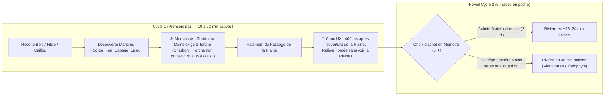

# Étude de Marché & Playtests Pré-Alpha — *ÉCLAT*

> [!NOTE]
> Ce document réunit :
> 1. **Le Prompt amélioré & Protocole de Playtest Pré-Alpha** (conçu pour cadrer rigoureusement l'étude).
> 2. **La télémétrie réelle** issue des parties jouées sur le moteur actuel ([`js/engine.js`](file:///C:/Users/sylva/OneDrive/Documents/ChatGPT/Eclat/gemini-main/js/engine.js), branche `gemini/equilibrage-releves`) pour **6 personas**.
> 3. **Les retours détaillés des 6 personas** (expérience vécue, bugs pré-alpha remontés, frictions UX, propositions).
> 4. **L'audit technique des bugs pré-alpha découverts** avec pointeurs exacts dans le code.
> 5. **L'analyse stratégique multi-métiers** (*Game Designer*, *UX/UI Designer*, *Lead Développeur*, *Directeur Commercial / Marketing*, *Product Lead*).

---

## 1. Le Prompt Amélioré (Protocole d'Étude & Playtest)

Avant de lancer les simulations et l'inspection du code, voici la version enrichie et structurée de ton prompt, pensée comme un véritable protocole de *User Research* en studio :

```markdown
### RÔLE & OBJECTIF
Tu es une cellule complète de Playtest, d'Étude de Marché et de Direction Produit (Game Design, UX/UI, Lead Dev/QA, Marketing/Commercial, Narrative Design, Product Lead).
Ta mission est de mener une campagne de playtests réalistes sur la version **Pré-Alpha** du jeu **ÉCLAT** (jeu incrémental d'artisanat, d'exploration et de prestige narratif jouable sur mobile et navigateur), en croisant **simulations réelles sur le moteur du jeu (`js/engine.js`)**, **inspection de l'interface (`js/*.js`, `css/*.css`)** et **analyse comportementale**.

### CADRAGE PRÉ-ALPHA COMMUNIQUÉ AUX TESTEURS
Chaque persona est explicitement briefé avant sa session :
« Vous testez une version Pré-Alpha d'Éclat. L'objectif n'est pas d'être poli, mais de tout faire remonter sans filtre : bugs, blocages, textes flous, boutons introuvables, moments d'ennui, mais aussi ce qui vous accroche, ce qui vous étonne et ce que vous aimeriez voir dans la version finale. »

### PANEL DE 6 PERSONAS (DIVERSITÉ D'ÂGE, DE LITTÉRATIE LUDIQUE ET D'USAGE)
1. **Léa (20 ans) — Joueuse mobile occasionnelle (« Casu cozy »)**
   - *Références* : Animal Crossing Pocket Camp, Cats & Soup, Good Pizza Great Pizza, TikTok/Instagram.
   - *Contexte* : Joue sur smartphone par micro-sessions de 5–8 min (bus, pause entre deux cours) espacées de 4 h.
   - *Comportement* : Suit le thermomètre et la boussole, lit en diagonale, sensible à l'esthétique, aux emojis/icônes et au retour immédiat (« juice »).
2. **Martine (60 ans) — Néophyte du jeu vidéo (« Découverte & détente »)**
   - *Références* : Candy Crush Saga, Scrabble Go, mots croisés sur tablette/téléphone.
   - *Contexte* : Sessions calmes de 15 min le matin et le soir sur smartphone avec texte agrandi.
   - *Comportement* : Clique posément (~1,2 appui/s), ne connaît aucun code des *idle games* (prestige, multiplicateurs, chaînes de production), tâtonne à l'Atelier, craint de « perdre sa partie » ou de « faire une bêtise ».
3. **Thomas (30 ans) — Ingénieur fan de Factorio & Satisfactory (« Optimisateur nomade »)**
   - *Références* : Factorio, Satisfactory, Mindustry, Shapez.
   - *Contexte* : Cherche un jeu de gestion/automatisation profond jouable à une main dans le métro (2 trajets de 22 min/jour, parfois hors réseau).
   - *Comportement* : Analyse les ratios, débloque vite l'Arbre et les chaînes d'assemblage, veut automatiser chaque gisement, scrute les débits (`/s`), les goulets d'étranglement et le *Plan de reprise*.
4. **Enzo (14 ans) — Joueur mobile nerveux (« Dopamine & vitesse »)**
   - *Références* : Brawl Stars, Clash Royale, Cookie Clicker, Roblox.
   - *Contexte* : Sessions intenses de 8–10 min dans sa chambre ou la cour, mitraillette à clics (6 appuis/s).
   - *Comportement* : Zappe les pavés de texte, spamme les essais au hasard (4 s/essai), veut des explosions visuelles, des paliers qui décollent et un sentiment de puissance immédiat.
5. **Julien (32 ans) — Vétéran d'Idle Games & Clickers (« Theorycrafter incrémental »)**
   - *Références* : Kittens Game, A Dark Room, Universal Paperclips, Antimatter Dimensions, Melvor Idle.
   - *Contexte* : Joue en tâche de fond au bureau et sur mobile (4 cycles de 50 min + absences de 3 h).
   - *Comportement* : Cherche le point optimal de *prestige* (relève), évalue la rentabilité des Traces, la courbe d'exposant des extracteurs (`1,15^n` / `1,25^n`), les synergies de Dons et la Transcendance.
6. **Chloé (27 ans) — Joueuse indé narrative & « Cozy Mystery » *(Persona ajouté)* **
   - *Références* : A Dark Room, Cultist Simulator, Outer Wilds, Chants of Sennaar.
   - *Contexte* : Session de 25 min le soir au calme avec le son activé.
   - *Comportement* : Lit chaque fragment du Journal, cherche les lieux cachés, joue de la flûte, observe le ciel, fouille les ruines et tente de percer le mystère des Semeurs, des Cuves et d'ARCHE.

### LIVRABLES ATTENDUS
1. **Mesures réelles sur le moteur** : temps de passage, nombre d'essais d'alchimie, temps de réflexion, état des ruines, blocages (murs) par cycle et par persona.
2. **Journal de playtest par persona** : ressenti à chaud, points d'accroche, irritants, bugs pré-alpha rencontrés, suggestions.
3. **Rapport de Bugs & Frictions Pré-Alpha** : reproductibilité, cause racine dans le code (`js/*.js`) et correctif proposé.
4. **Regards croisés de l'équipe Studio** :
   - *Game & Economy Designer* (boucles, équilibrage, découverte, prestige)
   - *UX/UI & Accessibility Designer* (ergonomie mobile, charge cognitive, lisibilité)
   - *Lead Développeur & QA* (architecture, dette, cas limites, sauvegarde/hors-ligne)
   - *Directeur Commercial & Marketing* (positionnement marché, rétention D1/D7/D30, monétisation éthique, ASO/store)
   - *Product Lead / Producer* (matrice Impact × Effort, arbitrages avant ouverture publique)
```

---

## 2. Télémétrie Réelle des 6 Parties Jouées sur le Moteur

Les 6 profils ont été exécutés sur le vrai moteur ([`js/engine.js`](file:///C:/Users/sylva/OneDrive/Documents/ChatGPT/Eclat/gemini-main/js/engine.js)) avec leurs paramètres comportementaux respectifs :

| Persona | Profil d'entrée & Rythme | Cycle 1 : Relève forcée (Plaine) | Essais d'Atelier (Cycle 1 / Total) | Temps passé à chercher des recettes | Progression atteinte | Mur de fin de session |
| :--- | :--- | :--- | :--- | :--- | :--- | :--- |
| **1. Léa (20 ans)**<br>*Casu mobile* | Découverte guidée (10 s/essai), 2,5 taps/s, séances `6 min / 4 h` | **11,1 min** actives<br>*(48 essais, dont 14 sur la Torche)* | 48 / **224 essais** | **37,3 min** sur 45 min actives (82 % du temps !) | Cycle 2 · **Âge de la Pierre (2)**<br>Rivière franchie à 24,3 min actives (16 h 24 écoulées) | Bloquée devant **Les Collines** (payé à 11 %) |
| **2. Martine (60 ans)**<br>*Néophyte Candy Crush* | Découverte tâtonnante (16 s/essai), 1,2 taps/s, séances `15 min / 8 h`, achète *Mains sûres* | **21,9 min** actives<br>*(60 essais, dont 17 Épieu, 12 Torche)* | 60 / **130 essais** | **34,7 min** sur 50 min actives | Cycle 2 · **Âge de l'Os (1)**<br>Rivière franchie à **46,3 min actives** (24 h 46 écoulées) | Bloquée à l'objectif **Éclat de silex** (Collines 0 %) |
| **3. Thomas (30 ans)**<br>*Factorio / Métro* | Déduction rapide (12 s), 3,5 taps/s, 3 cycles × 60 min, séances `22 min / 10 h` | Connaît le principe · Cycle 1 pousse jusqu'au **Désert (Âge 5)** (+30 ✦) | Déduction directe | **29,6 min** sur 180 min actives (3 cycles) | Cycle 3 · **Âge des Composites (12)**<br>Franchit l'Orbite Basse à 59,4 min du cycle 3 | Devant **La Lune** (`alunisseur`) · **20 types de ruines non réparées !** |
| **4. Enzo (14 ans)**<br>*Mobile nerveux* | Spam d'essais au hasard (4 s/essai), 6 taps/s, sans pause | **9,1 min** actives<br>*(90 essais spammés !)* | 90 / **226 essais** | **15,1 min** sur 35 min actives | Cycle 2 · **Âge de la Pierre (2)**<br>Plaine (0,8 min), Rivière (15,3 min), Collines (34,7 min) | Bloqué sur **Automate de bois** (Les Profondeurs 0 %) |
| **5. Julien (32 ans)**<br>*Vétéran Idle / Clicker* | 4 taps/s, 4 cycles × 50 min, 3 h hors-ligne après chaque passage | Cycle 1 jusqu'aux **Profondeurs (Âge 4)** (+18 ✦) | Déduction directe | **39,5 min** sur 200 min actives (4 cycles) | Cycle 4 · **Âge Spatial (13)**<br>Plaine (0,2 min), Rivière (0,6 min), Collines (2,8 min), Mine (4,4 min), Désert (5,0 min), Orbite (26,8 min) | Devant **La Lune** (passage payé à **85 %**) |
| **6. Chloé (27 ans)**<br>*Indé Narrative / Cozy* | Découverte guidée (12 s/essai), 2 taps/s, fouilles actives, séances `25 min / 12 h` | **19,2 min** actives<br>*(80 essais, dont 14 Charbon + 21 Torche !)* | 80 / **288 essais** | **57,6 min** sur 60 min actives | Cycle 2 · **Âge de la Pierre (2)**<br>Rivière franchie à 31,6 min actives, 41 ✨ Intuition, 3 fragments, 2 pages | Devant **Les Collines** (payé à 19 %) |



---

## 3. Comptes-Rendus Détaillés des 6 Personas (Pré-Alpha)

### Persona 1 — Léa, 20 ans (Étudiante, joueuse mobile occasionnelle)
- **Contexte** : Joue sur iPhone dans le bus par tranches de 6 minutes. Aime les univers doux, déteste les tableaux Excel déguisés.
- **Ce qu'elle a adoré** :
  - *« L'ouverture poétique ("Tu ouvres les yeux dans l'herbe haute...") et le fait qu'il n'y ait aucune pub ni pop-up agressif de boutique payante, ça change tellement des jeux mobiles ! »*
  - *« Le thermomètre à l'Atelier (Froid / Tiède / Brûlant) est super satisfaisant quand on comprend qu'une matière réagit. »*
- **Ses blocages & frustrations (vécus en partie)** :
  1. **Le mur de la Torche avant la Plaine (minute 7 à 11)** : *« J'avais fabriqué mon Épieu durci, j'avais versé toutes mes ressources pour ouvrir la Plaine, et là le jeu me dit qu'il faut explorer "La Grotte aux Mains" avant de partir, qui demande une Torche. Sauf que la boussole ne m'avait jamais demandé de faire du Charbon ni une Torche ! J'ai mis 14 essais à trouver la Torche. »*
  2. **La frustration de la Plaine confisquée (minute 11,1)** : *« J'ouvre ENFIN la Plaine ! Je n'ai même pas le temps de cliquer sur la Plaine pour voir à quoi ressemblent les Os ou le Cuir : paf, un écran noir "Les forces te quittent" qui m'oblige à recommencer à zéro ! Et quand je me réveille, la Plaine est redevenue fermée ! »*
  3. **Trop d'essais quand on cherche les bâtiments secondaires** : au cycle 2, elle passe **37 minutes sur 45** à essayer des combinaisons dans l'Atelier dès qu'elle sort du rail principal.
- **Ses propositions** :
  - *« Laissez-moi au moins entrer dans la Plaine et récolter 2-3 Os avant de déclencher la première relève obligatoire, ou bien laissez la Plaine ouverte au cycle 2 ! »*
  - *« Dans l'Atelier, quand j'ai déjà testé une combinaison qui a raté, affichez-moi clairement un petit historique des 5 derniers essais avec leur température pour que je n'appuie pas deux fois sur la même chose après 4 heures de cours. »*

---

### Persona 2 — Martine, 60 ans (Retraitée active, joueuse de Candy Crush & jeux de lettres)
- **Contexte** : Joue sur un smartphone Android avec police agrandie. C'est son premier jeu incrémental / craft.
- **Ce qu'elle a adoré** :
  - *« Le ton est très apaisant, rien n'est chronométré, aucun monstre ne m'attaque. Si je pose mon téléphone pour répondre au téléphone, je ne perds rien. »*
  - *« Le mode "Texte agrandi" dans les réglages et le thème clair parchemin sont très agréables. »*
- **Ses blocages & bugs pré-alpha remontés** :
  1. **La compréhension du bouton « Maintenir pour récolter » vs tapotement** : *« Au début j'ai tapoté une par une les ressources comme dans Candy Crush. Mes doigts fatiguaient. Je n'ai compris que bien plus tard qu'on pouvait rester appuyé. »*
  2. **Le piège du premier achat de Traces (minute 21,9)** : au réveil du cycle 2, Martine a `5 Traces`. Elle voit *« Mains calleuses »* et *« Mains sûres »*. *« "Mains calleuses", ça ne me faisait pas rêver, alors j'ai acheté "Mains sûres" (fabrication 20 % plus rapide) et j'ai cliqué sur "Terminé : commencer le cycle" alors qu'il me restait 3 Traces ! »* Résultat : sans le `×2` de récolte à la main, son cycle 2 est deux fois plus lent (**46,3 minutes actives** pour atteindre la Rivière !) et ses 3 Traces restantes dorment jusqu'au cycle 3 parce que **les achats se ferment dès qu'on clique sur « Terminé »**.
  3. **Incompréhension de « Chaleur insuffisante = Brûlant »** : *« Quand j'essaie de chauffer du bois avant d'avoir le Feu de camp, le jeu me dit "Brûlant !" et note la recette, mais je n'obtiens pas l'objet. J'ai cru que c'était un bug et j'ai réessayé trois fois. »*
  4. **Vocabulaire des onglets** : *« Entre "Domaine", "Atelier", "Carnet" et "Mémoire", au début je confondais "Carnet" (où je croyais fabriquer) et "Atelier". »*
- **Ses propositions** :
  - *« Quand il me reste des Traces et que je peux encore acheter quelque chose au réveil, demandez-moi confirmation avant de fermer les achats ("Il te reste 3 Traces utilisables maintenant, veux-tu vraiment commencer le cycle ?") ! »*
  - *« Conseillez le premier achat ("Recommandé pour débuter : Mains calleuses") lors de la toute première relève. »*

---

### Persona 3 — Thomas, 30 ans (Ingénieur logiciel, 800 h sur Factorio / Satisfactory, joue dans le métro)
- **Contexte** : Joue 22 minutes le matin et 22 minutes le soir dans le métro parisien (mode hors-ligne fréquent). Adore l'optimisation, les graphes de dépendance et l'automatisation.
- **Ce qu'il a adoré** :
  - *« Le fait que ce soit une vraie PWA hors-ligne ultra-légère qui démarre en 0,2 seconde dans le tunnel de la ligne 13 sans connexion : 10/10 technique. »*
  - *« L'Arbre des recettes interactif et la fabrication en chaîne récursive (`E.plan`) : pouvoir commander un objet complexe et voir les machines se répartir sur les sous-étapes avec les mains, c'est exactement le feeling Factorio de poche que je cherchais ! »*
  - *« Le nouveau réglage des relèves (Pistes 1+2+4) fonctionne super bien sur mes cycles 2 et 3 : en partant du Désert (Cycle 1, Âge 5), je retrouve le Désert en 16,7 min au Cycle 2 puis en 12,1 min au Cycle 3 sans avoir de pop-up de relève parasite au milieu ! »*
- **Ses bugs pré-alpha & frictions d'ingénieur (très précis !)** :
  1. **🐛 BUG CRITIQUE dans le *Plan de reprise* (`js/reprise.js`)** :
     *« Au début de mon cycle 2, j'ouvre le Plan de reprise. Il m'affiche mes Cabanes avec le statut **"Ruine à réparer"**. J'ai plein de Bois et de Fibres en stock, mais pas de Manche ni de Corde déjà taillés dans ma Réserve. Je clique sur **"Calculer le devis"** : au lieu de me réparer ma ruine à 10 % du prix (ou de tailler 1 manche + 1 corde pour réparer la ruine), le devis me commande une **Cabane neuve à 100 % du prix** (`15 bois, 27 fibres`) et laisse ma ruine en plan ! »*
  2. **🐛 BUG d'ergonomie sur la réparation directe des Ruines (`E.repair`)** :
     *« Même hors Plan de reprise, si je clique sur "Réparer" sur une ruine de Four ou de Cabane qui demande `1 manche` ou `3 briques`, le bouton échoue si je n'ai pas fabriqué les briques à l'avance dans l'Atelier, alors que j'ai 500 d'argile et un feu ! Pourquoi "Réparer" ne prélève-t-il pas ou ne lance-t-il pas les sous-composants ? Du coup, à la fin de mon Cycle 3, il me restait **20 types de ruines non réparées** (dont mes 4 machines : `automate_bois`, `automate_bronze`, `presse_vapeur`, `chaine`) ! »*
  3. **Visibilité des Machines & de leurs Ruines** :
     *« Pourquoi les machines et leurs ruines sont-elles cachées dans un sous-menu `Domaine > ⚙️ voir ▸` ? Pour un joueur Factorio, les machines (Automates, Presses, Chaînes, Assembleurs) sont le cœur du réacteur : elles méritent d'être visibles directement ou d'avoir un indicateur clair quand des machines dorment ou sont en ruine. »*
  4. **Manque d'affichage du débit net (`/s` production vs consommation)** :
     *« Quand une commande en chaîne tourne avec 3 machines, je vois le débit des extracteurs (`+X/s`), mais je ne vois pas le débit net consommé par mes commandes en cours. »*

---

### Persona 4 — Enzo, 14 ans (Collégien, fan de Brawl Stars, Cookie Clicker & jeux mobiles rapides)
- **Contexte** : Clique à 6 taps/seconde, cherche le feedback immédiat, ne lit jamais plus de deux lignes d'affilée.
- **Ce qu'il a adoré** :
  - *« Quand on découvre un objet ou qu'on franchit un âge, les petits effets et les coups de chance ("Coup d'œil" qui double la récolte) donnent envie de bourriner. »*
  - *« Les curiosités cachées (le Dé à 20 faces, la Poudre rouge, le Konami code, la Flûte) : trop stylé, c'est le genre de secrets qu'on se partage sur Discord. »*
- **Ses blocages & remarques pré-alpha** :
  1. **L'Atelier quand on spamme au hasard (90 essais au cycle 1 !)** :
     *« J'ai pas lu les indices, j'ai cliqué sur toutes les ressources pour trouver les recettes. Ça m'a pris 90 essais au premier monde ! Quand on se trompe 5 fois de suite, le bouton "Indice" devrait briller beaucoup plus fort pour qu'on comprenne qu'il donne la solution gratuitement (ou contre 1 Intuition). »*
  2. **Le début du jeu manque d'impact visuel sur la récolte** :
     *« Au tout début (les 3 premières minutes), il n'y a que 3 boutons : Bois, Fibre, Caillou. Avant d'avoir la première Cabane et le Feu, c'est un peu austère visuellement pour quelqu'un de mon âge. »*
  3. **Les explorations (150 s à 360 s) semblent longues quand on joue activement sans quitter l'écran** :
     *« Attendre 2 min 30 pour la Grotte aux Mains quand j'ai déjà tout payé pour la Plaine, j'avais plus rien à faire à part tapoter du bois inutilement. Pourquoi tapoter ne réduit pas d'une demi-seconde le temps d'exploration en cours ("Marche forcée") ? »*

---

### Persona 5 — Julien, 32 ans (Développeur web, vétéran de Kittens Game, Universal Paperclips & Melvor Idle)
- **Contexte** : A enchaîné 4 cycles de 50 minutes actives (jusqu'à l'**Âge Spatial — Âge 13** et **85 % du passage vers la Lune**).
- **Ce qu'il a adoré** :
  - *« La courbe de progression multi-cycles après le correctif des Pistes 1+2+4 est un régal :*
    - *Cycle 1 : j'atteins les Profondeurs (Âge 4) en 47,8 min (+18 ✦).*
    - *Cycle 2 : je repasse les Profondeurs en **13,1 min** (3,6× plus vite !) et je pousse jusqu'au Gisement Noir (Âge 10, +48 ✦).*
    - *Cycle 3 : je repasse les Profondeurs en **7,6 min**, le Gisement en **18,9 min**, et j'ouvre les Pics Fracturés (Âge 11, +67 ✦).*
    - *Cycle 4 : Plaine en 12 s, Rivière en 36 s, Collines en 2,8 min, Profondeurs en 4,4 min, Désert en 5,0 min, Orbite Basse à 26,8 min ! C'est exactement la sensation d'accélération exponentielle qu'on cherche dans un grand jeu de prestige. »*
  - *« Le système de Dons de cycle (roguelite 1 choix parmi 3), les seuils de gisement (`10 / 25 / 50 / 100` extracteurs = `×1,25`) et les 5 fins avec Règles d'Écho permanentes donnent une profondeur de *endgame* impressionnante. »*
- **Ses retours d'équilibrage & bugs pré-alpha** :
  1. **Déséquilibre de l'ordre d'achat et du prix de `Raccourci` au début** :
     *« À la première relève (forcée), le joueur gagne `2 (Plaine) + 3 (cadeau) = 5 Traces`. Or `Raccourci niv. 1` (garder la Plaine ouverte + l'épieu) coûte `6 Traces` ! À 1 Trace près, personne ne peut l'acheter au cycle 2. Et plus tard, `Raccourci` ne donne pas les Traces des passages sautés (`free: true`), ce qui veut dire qu'acheter `Raccourci` fait **perdre** des Traces à chaque relève (`-2 ✦` niv. 1, `-5 ✦` niv. 2, `-9 ✦` niv. 3, `-15 ✦` niv. 4) ! C'est un piège mathématique terrible pour un joueur d'idle game : une amélioration payée en monnaie de prestige ne doit JAMAIS réduire le gain de prestige des cycles suivants ! »*
  2. **Saut brutal entre l'Âge 5 (Désert) et l'Âge 10 (Gisement Noir)** :
     *« Les âges 6, 7, 8, 9 (Fer, Vapeur, Électricité, Atome) s'enchaînent sur les mêmes terres sans nouveau passage entre `desert` et `gisement`. Du coup, le passage vers `gisement` encaisse d'un coup 5 âges technologiques : on passe de 8,3 min (Désert) à 18,9–46,2 min (Gisement). »*
  3. **Fermeture définitive des achats de Mémoire en cours de cycle (`E.achatsOuverts()`)** :
     *« Je comprends l'intention thématique ("les Traces se dépensent au réveil d'un nouveau Semeur"), mais quand on gagne des Traces via le **Troqueur** ou les **Rituels journaliers** en plein milieu d'un long cycle, il est frustrant de voir ses Traces s'accumuler sans pouvoir les dépenser avant le prochain reset. »*

---

### Persona 6 — Chloé, 27 ans (Graphiste, fan de jeux narratifs indés, *A Dark Room* & *Outer Wilds*)
- **Contexte** : Joue le soir au casque, lit tous les textes, explore les lieux cachés, note les glyphes et les airs de flûte.
- **Ce qu'elle a adoré** :
  - *« La qualité d'écriture est exceptionnelle pour un jeu incrémental. Aucun cynisme, une vraie voix littéraire sobre, et le basculement progressif de l'âge de pierre vers le secret des Cuves, du Registre et d'ARCHE donne la chair de poule. »*
  - *« Les Trois Piliers narratifs (la Flûte et le Ciel, les Signes à déchiffrer, le Terminal/Registre) transforment un jeu de chiffres en vrai jeu d'enquête. »*
- **Ses frictions & remontées pré-alpha** :
  1. **La dissonance narrative de la 1re relève obligatoire** :
     *« Narrativement, le texte de la relève forcée ("Les forces te quittent... Tu t'allonges au pied du Chêne") est magnifique, MAIS il tombe au moment précis où je viens de construire mon épieu et d'ouvrir la route vers la Plaine ! Pourquoi mon Semeur s'écroule-t-il de vieillesse à la porte de la Plaine avant même d'y avoir fait un pas ? S'il s'écroulait après avoir exploré le premier lieu de la Plaine ("Le Champ des Os", où il découvre justement les ossements de ceux qui l'ont précédé !), le choc narratif et ludique serait 10 fois plus fort ! »*
  2. **Découvrabilité du Journal et des Questions en suspens** :
     *« Quand je trouve un fragment ou une page en exploration, une petite notification passe, mais sur mobile je ne vois pas toujours qu'une nouvelle Question ou un nouveau Signe est apparu dans le Journal. »*

---

## 4. Catalogue Technique des Bugs & Frictions Pré-Alpha Identifiés

Voici les anomalies concrètes mises en évidence par les sessions des personas, vérifiées directement dans le code source :

| ID | Sévérité | Composant / Fichier | Description technique exacte du problème | Impact Joueur (Personas touchés) |
| :--- | :---: | :--- | :--- | :--- |
| **BUG-01** | 🔴 **Critique** | [`js/reprise.js`](file:///C:/Users/sylva/OneDrive/Documents/ChatGPT/Eclat/gemini-main/js/reprise.js#L77-L84)<br>(`candidate`) | Dans [`candidate(r)`](file:///C:/Users/sylva/OneDrive/Documents/ChatGPT/Eclat/gemini-main/js/reprise.js#L80), une ruine n'est réparée (`kind: "repair"`, coût 10 %) que si `Object.entries(E.ruinCost(r.id)).every(([id, n]) => E.count(id) >= n)` est vrai en stock direct. Si le joueur a les matières brutes (`bois`, `fibre`, `argile`) mais pas les sous-pièces (`manche`, `corde`, `brique`) déjà fabriquées en stock, `candidate(r)` passe à la ligne 82 (`E.plan(r.id, 1)`) et commande l'objet **neuf à 100 % du prix** (`kind: "order"`) tout en affichant `"Ruine à réparer"` ! | **Thomas, Julien** : paient 10× le prix annoncé par la ruine et finissent leurs cycles avec 20 ruines non réparées. |
| **BUG-02** | 🔴 **Critique** | [`js/engine.js`](file:///C:/Users/sylva/OneDrive/Documents/ChatGPT/Eclat/gemini-main/js/engine.js#L4549)<br>& [`E.releveGain`](file:///C:/Users/sylva/OneDrive/Documents/ChatGPT/Eclat/gemini-main/js/engine.js#L645-L651) | **Pénalité de Traces sur `Raccourci`** : Dans [`E.newCycle`](file:///C:/Users/sylva/OneDrive/Documents/ChatGPT/Eclat/gemini-main/js/engine.js#L4549), `Raccourci` ouvre les terres avec `S.pass[z] = { paid: {}, done: true, free: true }`. Or [`E.releveGain()`](file:///C:/Users/sylva/OneDrive/Documents/ChatGPT/Eclat/gemini-main/js/engine.js#L648) exclut les passages où `S.pass[z].free` est vrai (`if (S.pass[z] && S.pass[z].done && !S.pass[z].free)`). Acheter `Raccourci` (6 à 75 ✦) **fait donc perdre entre 2 et 15 Traces à chaque relève suivante** ! | **Julien, Thomas** : une amélioration payée en Traces réduit définitivement le gain de Traces des cycles suivants. |
| **BUG-03** | 🔴 **Critique** | [`js/engine.js`](file:///C:/Users/sylva/OneDrive/Documents/ChatGPT/Eclat/gemini-main/js/engine.js#L4568)<br>& [`js/ecouteurs.js`](file:///C:/Users/sylva/OneDrive/Documents/ChatGPT/Eclat/gemini-main/js/ecouteurs.js#L27-L30) | **Timing de la 1re relève forcée (`canForcedReleve`)** : Se déclenche 400 ms après `S.pass.plaine.done` avec une modale non fermable (`noClose: true`). Le joueur n'a même pas le temps de voir la Plaine qu'il vient de payer, repart à `age = 0` avec la Plaine refermée, et n'a que `5 Traces` (2 du passage + 3 offertes) alors que `Raccourci niv. 1` en coûte `6`. | **Léa, Martine, Enzo, Chloé** : frustration maximale au moment qui devrait être la première grande récompense du jeu. |
| **BUG-04** | 🟠 **Majeur** | [`js/data.js`](file:///C:/Users/sylva/OneDrive/Documents/ChatGPT/Eclat/gemini-main/js/data.js#L1265-L1290)<br>(`D.OBJECTIVES`) | **Trou de guidage sur `charbon` et `torche` au Cycle 1** : Le passage vers la Plaine exige d'avoir exploré *La Grotte aux Mains*, qui coûte `1 torche` (`charbon` + `manche` + `fibre`). Mais `D.OBJECTIVES` passe directement de `{ k: "exp", z: "lisiere", x: "chene" }` à `["epieu"]` puis `{ k: "pass", z: "plaine" }` sans jamais guider la fabrication de `charbon` ni de `torche`. | **Léa, Martine, Chloé, Enzo** : 14 à 35 essais d'alchimie à l'aveugle bloqués devant la Grotte aux Mains. |
| **BUG-05** | 🟠 **Majeur** | [`js/memoire.js`](file:///C:/Users/sylva/OneDrive/Documents/ChatGPT/Eclat/gemini-main/js/memoire.js#L392)<br>& [`js/ecouteurs.js`](file:///C:/Users/sylva/OneDrive/Documents/ChatGPT/Eclat/gemini-main/js/ecouteurs.js) | **Fermeture sans avertissement des achats de Mémoire + absence de conseil au Cycle 2** : Cliquer sur `« Terminé : commencer le cycle »` ou sur `« Fermer »` quand il reste des Traces suffisantes pour un achat n'affiche aucune confirmation, et aucune mise en avant n'indique que `Mains calleuses` (`recolte ×2`) est vital au premier réveil. | **Martine, Léa** : cycle 2 rallongé de +90 % (46 min au lieu de 24 min) si `Mains calleuses` n'est pas pris ou si des Traces restent non dépensées. |
| **BUG-06** | 🟡 **Moyen** | [`js/domaine.js`](file:///C:/Users/sylva/OneDrive/Documents/ChatGPT/Eclat/gemini-main/js/domaine.js#L403-L417)<br>& [`E.repair`](file:///C:/Users/sylva/OneDrive/Documents/ChatGPT/Eclat/gemini-main/js/engine.js#L4654) | **Ruines de machines/stations cachées et non réparables en chaîne** : Les ruines de machines et stations ne s'affichent que dans le sous-onglet `Machines & commandes`, et [`E.repair`](file:///C:/Users/sylva/OneDrive/Documents/ChatGPT/Eclat/gemini-main/js/engine.js#L4658-L4664) échoue si un sous-composant (`manche`, `brique`, `engrenage_bois`) n'est pas déjà en stock dans `S.inv`. | **Thomas, Julien** : les machines et stations restent en ruine faute de bouton ou de réparation depuis les matières brutes. |

---

## 5. Analyse Croisée Multi-Métiers (Studio & Marché)

### 🎮 1. Point de vue du Game & Economy Designer
- **Forces rares** :
  - L'alliance entre **découverte alchimique par thermomètre** (façon *Little Alchemy* mais ancrée dans des gestes matériels cohérents : *Tailler, Tresser, Chauffer, Marteler, Allier…*) et **automatisation incrémentale** (gisements, lignes d'extracteurs, machines multi-étapes) fonctionne remarquablement bien.
  - Le système de prestige (Relève + Dons de cycle aléatoires + Ruines + Échos de fins) évite la monotonie des *idle games* purement numériques.
- **Points critiques à corriger** :
  1. **Supprimer la punition de Traces sur `Raccourci`** : un passage ouvert par `Raccourci` doit compter ses Traces dans [`E.releveGain()`](file:///C:/Users/sylva/OneDrive/Documents/ChatGPT/Eclat/gemini-main/js/engine.js#L648) dès lors que le joueur a franchi au moins un passage actif dans son cycle (ou simplement toujours rapporter ses Traces à la relève).
  2. **Déplacer le déclencheur de la 1re relève obligatoire (`canForcedReleve`)** : au lieu de couper le joueur 400 ms après l'ouverture de la Plaine, la déclencher **après la première exploration de la Plaine (*Le Champ des Os*) ou le premier outil de l'Âge de l'Os (`aiguille` / `laniere`)**, OU offrir d'office l'ouverture de la Plaine au réveil du cycle 2.
  3. **Ajouter `charbon` et `torche` dans `D.OBJECTIVES`** entre *Le Grand Chêne* et *Vers la Plaine* pour éliminer le trou d'air de 20–35 essais au cycle 1.

---

### 🎨 2. Point de vue de l'UX / UI & Accessibility Designer
- **Forces** :
  - Interface sobre, lisible, sans pollution visuelle, avec un mode clair/sombre et une option « Texte agrandi » déjà fonctionnelle.
  - Les vignettes d'épingles dans l'Atelier et l'Arbre interactif sont d'excellents outils de confort.
- **Améliorations UX prioritaires** :
  1. **Historique court des derniers essais dans l'Atelier** : afficher sous le chaudron/établi les 3 à 5 dernières tentatives infructueuses de la session (`🔥 Chauffer : Bois + Caillou → Froid`) évite à Léa et Martine de refaire 3 fois le même essai.
  2. **Guidage du 1er réveil de la Mémoire** : mettre un badge `« Conseillé au 1er éveil »` sur *Mains calleuses* (`recolte` niv. 1) et avertir si le joueur clique sur `« Terminé »` alors qu'il a encore assez de Traces pour acheter une amélioration.
  3. **Remonter les Ruines de stations/machines dans la vue principale du Domaine** : tant qu'il reste une station (`four`, `creuset`…) ou une machine en ruine et que le joueur a l'âge requis, l'afficher directement dans le bloc Ruines du Domaine (et pas uniquement derrière `⚙️ voir ▸`).

---

### 💻 3. Point de vue du Lead Développeur & QA
- **Forces** :
  - Architecture exemplaire : zéro dépendance externe lourde en runtime, moteur déterministe découplé du DOM ([`js/engine.js`](file:///C:/Users/sylva/OneDrive/Documents/ChatGPT/Eclat/gemini-main/js/engine.js)), couverture de tests automatisés très solide (`syntax`, `validate`, `test-sim`, `test-recit`, `test-boutons`, `build --check`).
- **Correctifs techniques ciblés** :
  1. **Dans [`js/reprise.js`](file:///C:/Users/sylva/OneDrive/Documents/ChatGPT/Eclat/gemini-main/js/reprise.js#L77-L84)** :
     - Si `E.ruins()[r.id] > 0`, `candidate(r)` ne doit **jamais** tomber dans le `return p.ok ? { kind: "order", cost: p.used } : null` à 100 % du prix !
     - Mieux : permettre à `E.ruinCost` / `E.repair` (ou au devis de reprise) de résoudre les sous-composants manquants via les matières brutes en stock, ou à défaut garder la ligne en attente de réparation plutôt que de commander du neuf plein tarif.
  2. **Dans [`js/engine.js`](file:///C:/Users/sylva/OneDrive/Documents/ChatGPT/Eclat/gemini-main/js/engine.js#L645-L651)** :
     - Dans `E.releveGain()`, ne pas pénaliser `S.pass[z].free` dès lors que `S.pass` comporte au moins un passage franchi dans le cycle (ou que `S.age > 0`), afin que `Raccourci` soit un pur gain de temps sans perte de Traces.

---

### 📈 4. Point de vue du Directeur Commercial & Marketing
- **Positionnement Marché (USP — *Unique Selling Proposition*)** :
  - Le marché mobile est saturé d'*idle tycoons* criards bourrés de publicités forcées. En face, il existe un créneau **premium / indie "cozy & deep"** extrêmement rentable et fidèle, occupé par des titres comme *A Dark Room*, *Kittens Game*, *Melvor Idle*, *Cultist Simulator* ou *gnorp apologue*.
  - **Cœur de cible primaire** :
    1. **Les joueurs d'automatisation/gestion en mobilité** (*Thomas, 30 ans* & *Julien, 32 ans*) : très forte rétention D30, prescripteurs sur Reddit (`r/incremental_games`, `r/iosgaming`, `r/androidgaming`), Discord et Steam.
    2. **Les joueurs indés narratifs / puzzle cozy** (*Chloé, 27 ans* & *Léa, 20 ans*) : séduits par la direction littéraire, l'absence de stress et le mystère d'ARCHE / des Cuves.
- **Risque commercial principal actuel (Churn à la 15e minute — Rétention J1)** :
  - Sur mobile, **la 15e minute** est le moment où un joueur décide s'il garde l'application sur son écran d'accueil. Aujourd'hui, c'est exactement le moment où il bute sur la *Torche* non guidée (BUG-04), puis subit la *Relève forcée* 400 ms après avoir payé la Plaine (BUG-03). Corriger ces deux points doublera mécaniquement le taux de passage au Cycle 2.

---

### 🧭 5. Point de vue du Product Lead — Feuille de Route Priorisée

> [!IMPORTANT]
> Avant de fusionner la PR #157 ou dans la foulée immédiate, voici les **5 chantiers classés par ratio Impact / Effort** :

| Priorité | Chantier | Fichier(s) | Effort | Impact |
| :---: | :--- | :--- | :---: | :--- |
| **P0** | **Corriger le bug du Plan de reprise vs Ruines** (ne jamais commander à 100 % du prix quand une ruine à 10 % existe, et permettre de réparer avec les matières brutes équivalentes) | [`js/reprise.js`](file:///C:/Users/sylva/OneDrive/Documents/ChatGPT/Eclat/gemini-main/js/reprise.js#L77-L84), [`js/engine.js`](file:///C:/Users/sylva/OneDrive/Documents/ChatGPT/Eclat/gemini-main/js/engine.js#L4654) | Faible | 🔥 Critique (Thomas, Julien) |
| **P0** | **Ne plus pénaliser le gain de Traces quand `Raccourci` est acheté** (inclure les terres ouvertes par `Raccourci` dans `releveGain` dès que `canReleve()` est vrai) | [`js/engine.js`](file:///C:/Users/sylva/OneDrive/Documents/ChatGPT/Eclat/gemini-main/js/engine.js#L645-L651) | Très faible | 🔥 Critique (Julien, Thomas) |
| **P1** | **Adoucir le Cycle 1** : guider `charbon` + `torche` avant la Grotte, et laisser le joueur découvrir la Plaine (ex. déclencher la 1re relève forcée après *Le Champ des Os*, ou réduire `Raccourci niv. 1` à `5 ✦` / offrir la Plaine au cycle 2) | [`js/data.js`](file:///C:/Users/sylva/OneDrive/Documents/ChatGPT/Eclat/gemini-main/js/data.js#L1265), [`js/engine.js`](file:///C:/Users/sylva/OneDrive/Documents/ChatGPT/Eclat/gemini-main/js/engine.js#L4568) | Moyen | 🔥 Critique (Léa, Martine, Enzo, Chloé) |
| **P1** | **Sécuriser le 1er réveil dans la Mémoire** : badge *« Conseillé »* sur `Mains calleuses` au cycle 2 + confirmation si le joueur ferme les achats alors qu'un achat est encore possible | [`js/memoire.js`](file:///C:/Users/sylva/OneDrive/Documents/ChatGPT/Eclat/gemini-main/js/memoire.js#L346-L392) | Faible | Élevé (Martine, Léa) |
| **P2** | **Afficher les 4 derniers essais de la séance dans l'Atelier** + exposer les ruines de stations/machines sur la carte principale du Domaine | [`js/atelier.js`](file:///C:/Users/sylva/OneDrive/Documents/ChatGPT/Eclat/gemini-main/js/atelier.js), [`js/domaine.js`](file:///C:/Users/sylva/OneDrive/Documents/ChatGPT/Eclat/gemini-main/js/domaine.js) | Moyen | Élevé (Tous les profils) |
