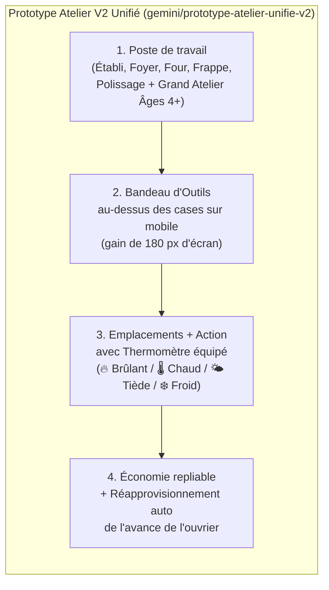

# Passation (Handoff) & Prototype d'Atelier V2 Unifié

> [!IMPORTANT]
> Ce document est conçu pour permettre une reprise immédiate par **Gemini Flash** ou **Claude** sans aucune perte de contexte, tout en présentant le prototype fonctionnel réalisé sur la branche **`gemini/prototype-atelier-unifie-v2`**.

---

## 1. Le Prototype réalisé : ma vision de l'Atelier V2 après les retours des 6 Personas

Sur la branche `gemini/prototype-atelier-unifie-v2` (dans `C:\Users\sylva\OneDrive\Documents\ChatGPT\Eclat\gemini-preview`), j'ai implémenté un prototype concret qui garde **tout ce que les 6 personas ont adoré dans la V2** (les outils durables non consommés comme l'aiguille, le gain de vitesse mesuré du couteau ×2, les modes du foyer, l'esthétique dessinée) tout en corrigeant **les 4 irritants majeurs** :

### Détail des 6 évolutions du prototype :
1. **Le Thermomètre équipé enrichi & Réminiscence ([`js/equipements.js`](file:///C:/Users/sylva/OneDrive/Documents/ChatGPT/Eclat/gemini-preview/js/equipements.js#L149-L210) & [`js/atelier-equipe.js`](file:///C:/Users/sylva/OneDrive/Documents/ChatGPT/Eclat/gemini-preview/js/atelier-equipe.js#L260-L265))** :
   - Sans violer l'isolation stricte des tests (aucune dépense ni révélation prématurée en cas de mauvais outil), tout essai infructueux affiche désormais un vrai retour thermique gradué dans `#ae-result` :
     - **🔥 Brûlant** : matières exactes pour ce poste (mais autre outil ou autre allure), **OU matière superflue** détectée (*« Cet outil et ce geste reconnaissent ces matières, mais l’une d’entre elles est superflue sur l’établi. »*).
     - **🌡️ Chaud** : les matières forment bien une recette de l'âge actuel, mais sur un autre poste de travail (indiqué au joueur).
     - **🌤️ Tiède** : cet outil et ce geste travaillent bien l'une des matières posées, avec décompte des ingrédients manquants et attendus (*« il manque N ingrédient(s) (M matières attendues). »*).
     - **❄️ Froid** : aucune réaction entre cet outil et ces matières.
   - **Récompense de Réminiscence** : les essais chauds et brûlants nourrissent l'apprentissage via `E.remember(w.mode, w.slots)`.
2. **Continuité après le Cuivre : le poste « Grand Atelier (Âges 4+) » intégré dans [`js/atelier-equipe.js`](file:///C:/Users/sylva/OneDrive/Documents/ChatGPT/Eclat/gemini-preview/js/atelier-equipe.js#L17-L56)** :
   - Plus besoin de quitter l'Atelier V2 à l'Âge 4 : un poste **« Grand Atelier (Âges 4+) »** apparaît directement dans la barre des postes `.ae-posts` et permet de fabriquer et découvrir les 180 recettes du Bronze au Stellaire dans la même interface dessinée.
3. **Ergonomie mobile repensée dans [`css/atelier-equipe.css`](file:///C:/Users/sylva/OneDrive/Documents/ChatGPT/Eclat/gemini-preview/css/atelier-equipe.css#L57-L60)** :
   - Sur mobile (`<= 1100px`), le sélecteur d'outils `.ae-tools` passe **au-dessus** des 3 emplacements de l'établi (`order: -1`) sous forme de bandeau horizontal compact, suivant l'ordre naturel du geste : **Poste → Outil → Matières → Action**.
4. **Rethématisation narrative de l'Apprenti & Monnaie d'époque (`currencyName(age)`)** :
   - Remplacement du vocabulaire fiscal/industriel anachronique par **Apprenti**, **part réservée** et **accueillir**.
   - Monnaie dynamique : *rations de troc* (0–1), *coquillages* (2–3), *écus* (4–6), *florins* (7–8), *crédits* (9+).
5. **Apprenti autonome et encart économique repliable ([`js/atelier-economie.js`](file:///C:/Users/sylva/OneDrive/Documents/ChatGPT/Eclat/gemini-preview/js/atelier-economie.js#L53-L63) & [`js/atelier-equipe.js`](file:///C:/Users/sylva/OneDrive/Documents/ChatGPT/Eclat/gemini-preview/js/atelier-equipe.js#L98-L103))** :
   - Ajout d'une case **« Réapprovisionner la part réservée »** (`#ae-autofund`, `E.workerAutoFund`) et d'un bouton **« Avancer 5 [monnaie] »** : tant que la bourse contient au moins 1 unité de monnaie (alimentée par le troqueur), l'apprenti ne tombe plus en panne toutes les 56 secondes.
   - L'encart économique est placé dans un `
` repliable pour ne plus repousser les *Commandes* tout en bas de l'écran sur téléphone.

---

## 2. Vision Directrice : « L'Atelier-Laboratoire (*Vintage Story / Valheim* en 2D Mobile) »

Implémentée dans le commit `b30aff1` sur **PR #166** ([`js/atelier-equipe.js`](file:///C:/Users/sylva/OneDrive/Documents/ChatGPT/Eclat/gemini-preview/js/atelier-equipe.js#L168-L214)) et gravée au cœur de [`docs/HANDOFF-ATELIER-V2-ET-SUITE.md`](file:///C:/Users/sylva/OneDrive/Documents/ChatGPT/Eclat/gemini-preview/docs/HANDOFF-ATELIER-V2-ET-SUITE.md) :

1. **L'Atelier = un Laboratoire d'expérimentation tactile** : comme dans *Vintage Story* ou *Valheim*, on choisit un **Poste** (Établi, Foyer, Four, Enclume) et un **Outil / Geste** pour tester des matières brutes et provoquer l'Eurêka.
2. **Une fois la recette découverte, la fabrication se simplifie et l'automatisation prend le relais** : on ne refait jamais la manipulation de laboratoire pour produire en série — la recette découverte est repliée dans `
` et se lance en **1 clic** dans les *Commandes / Carnet*, avant d'être confiée aux **Machines et Cadences d'atelier**.
3. **Filtrage et tri automatiques des matières étudiées** (fini la liste « longue comme le bras ») :
   - **En tête avec le badge `✦ Piste`** : les matières étudiées qui réagissent encore avec l'outil et le geste actuellement en main (`E.equipmentHasDiscovery(id, w.eq, w.mode)`).
   - **Ensuite** : les matières non encore étudiées.
   - **Écartées automatiquement du plateau** : les matières étudiées qui ont déjà livré tous leurs secrets (`E.state.studied[id] && totalReactions === 0`), avec un bouton discret *« Tout voir (+N étudiées) »* (`#ae-exhausted-note`).

---

## 3. Fiche de Passation Technique (pour Gemini Flash / Claude)

La documentation complète a également été enregistrée directement dans le dépôt sous [`docs/HANDOFF-ATELIER-V2-ET-SUITE.md`](file:///C:/Users/sylva/OneDrive/Documents/ChatGPT/Eclat/gemini-preview/docs/HANDOFF-ATELIER-V2-ET-SUITE.md).

### État des dépôts locaux et branches Git
- **Worktree `main`** : `C:\Users\sylva\OneDrive\Documents\ChatGPT\Eclat\gemini-main`
  - Branche : `main` (`ca506df`, poussée sur `origin/main`, 100 % des tests au vert).
  - Contient : PR #157 (Relèves), PR #160 (Correctifs pré-alpha), PR #161 (Lot 1 : C & D), PR #164 (Lot 2 : A & B).
- **Worktree `preview`** : `C:\Users\sylva\OneDrive\Documents\ChatGPT\Eclat\gemini-preview`
  - Branche de base : `prewiew-design` (`b19cd7c`, poussée sur `origin/prewiew-design`, synchronisée avec `main`).
  - Branche du prototype : `gemini/prototype-atelier-unifie-v2` (poussée sur `origin`, PR ouverte vers `prewiew-design`).

### Règles d'or du projet à respecter par le prochain agent
1. **Ne jamais fusionner `prewiew-design` dans `main`** tant que le choix définitif sur l'Atelier V2 n'est pas validé (`prewiew-design` utilise `SAVE_VERSION = 13` dans `js/equipements.js` contre `12` sur `main`).
2. **Avant chaque commit** :
   - Exécuter `node tools/test-boutons.js --write` si un bouton HTML a été ajouté ou modifié (chaque bouton doit avoir un `title` ou `aria-label` explicite et une taille minimale de `44×44 px`).
   - Exécuter `node tools/build.js` pour mettre à jour l'empreinte SHA-256 dans `sw.js`.
   - Exécuter `npm test` pour vérifier l'ensemble des suites unitaires.
