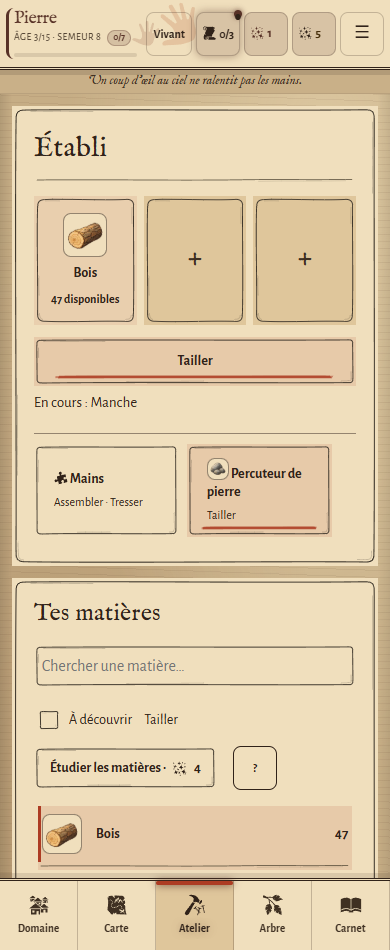
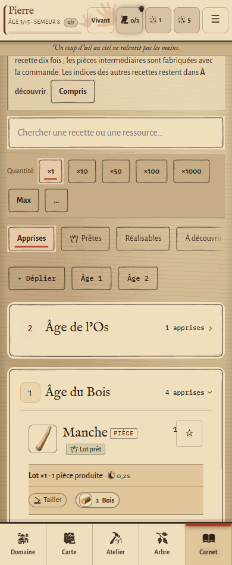

# Interface dessinée — Atelier et Carnet

Cette itération prolonge l’intégration de Gemini dans la preview (`39a7b0e`, menu et Domaine). Elle habille les véritables écrans Atelier et Carnet lorsque le style **Vivant** est actif.

L’habillage est également porté sur `main`. Le test navigateur détecte la présence du module d’équipements : il exerce l’Atelier historique sur `main`, et les deux parcours sur la preview. Les captures ci-dessous proviennent de la preview équipée ; `main` conserve son moteur et ses sauvegardes habituels.

## Composition

Les feuilles regroupent le poste et les matières ; les lignes de réserve et les recettes sont séparées par des filets d’encre. Les emplacements reçoivent un cadre dessiné. Un lavis et un trait de pigment désignent les outils et les commandes sélectionnés. Les matières gardent leurs couleurs et prennent davantage de place : 40 px dans la réserve équipée, 44 px sur l’établi et 48 px en tête des recettes.

Les ressources graphiques sont les SVG éditables déjà intégrés dans `assets/ui/`, déployés par bordures en neuf parties et masques décoratifs. Le texte reste natif, sélectionnable et adaptable. Le support et la typographie continuent d’évoluer selon l’époque. Aucun nouveau bitmap d’interface n’est nécessaire.

La feuille `css/atelier-dessine.css` est séparée de celle du Domaine. Elle ne s’applique qu’au style Vivant. Les procédés historiques accessibles depuis l’Atelier reçoivent les mêmes contours. Les illustrations de l’Os livrées séparément ne sont pas intégrées par cette modification : le registre existant continue à décider des images disponibles.

## Essayer

Ouvrir le jeu, puis utiliser le bouton de style en haut pour passer de **Atlas** à **Vivant**. Ouvrir l’Atelier puis le Carnet. Les données et sauvegardes sont celles du moteur existant. Le paramètre `?atelier=classique` permet toujours le parcours historique.

Captures d’une partie de contrôle jetable :

## Validation

- `npm test` : suite complète réussie.
- `npm run test:atelier-dessine` : 276 contrôles réussis ; 320, 390 et 1280 px, clair et sombre avec grands textes, Atelier équipé et procédés historiques.
- Parcours : poser/retirer une matière, recherche Peau, filtre de découverte natif, focus clavier, fabrication réelle d’un manche, ouverture d’un âge du Carnet, conservation du thème et retour au style classique.
- Affichage : illustrations visibles chargées, ressources sans erreur 404, aucune erreur JavaScript, largeur de page, cibles d’au moins 44 px et contraste des boutons principaux d’au moins 4,5:1.
- Contrôles complémentaires du Carnet aux âges d’indices 0, 5, 10 et 14 pour les supports successifs.
- Service worker recalculé ; tracés existants et nouvelle feuille disponibles dans le cache.

Les captures illustrent les premiers âges. La composition artistique des écrans tardifs et des cas de sauvegardes très chargées reste à apprécier en jeu. Ce lot n’est pas une refonte du moteur, des recettes ou de l’économie.
